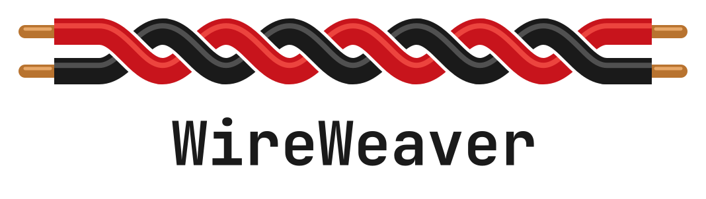

# WireWeaver

<picture>
  <source media="(prefers-color-scheme: dark)" srcset="https://raw.githubusercontent.com/vhrdtech/wire_weaver/master/docs/assets/wire_weaver_logo-dark.png">
  
</picture>

WireWeaver turns one Rust trait into a typed API between programs: firmware on a small microcontroller and the tools on a PC, two processes on one computer, or a service and the scripts that drive it. The trait declares methods, properties and streams, and `ww_codegen!` generates the server and the client from it, for `no_std` and `std`, async or blocking. Generated code does no IO, so the same API runs over USB, RTT, WebSocket, UDP, a local socket or in-process. Values travel in `shrink_wrap`, a bit-packed, zero-copy wire format that needs no allocator, stays compatible in both directions as types grow, and is as useful for many small objects on a PC as it is on a device.

- **Evolution that is checked.** `ww api check` compares an API with its saved snapshots and says which version position to bump. A newer host works with an older device and the reverse, and each connection checks that the two sides agree.
- **Numbers carry their units.** A timeout is `Millis<u16>` and a battery level is `Fixed<Ratio, Centi, u8, Range<0, 100>>`: the same bytes as the bare integer, with bounds checked on decode, before a handler runs.
- **Servers on hosts too.** `wire_weaver_server` serves one API to many clients. The hub holds each device in one process per user and shares it with every program on the computer. A local trait (a prototype) lets one call site use a struct in the same process or a client of another one.
- **Devices describe themselves.** A device sends its API as introspection data, so the Python module and the dynamic client call any device without generated code. Every effectful item declares what it does (`read`, `edit`, `persist`, `destructive`, `actuate`, ...), and a tool can tell a read from a write that moves hardware.
- **Firmware cost is measured.** Stack, instructions and flash of the device side are measured in QEMU and on real chips. One conformance corpus keeps the derive, the dynamic client, Python and C byte-identical.

WireWeaver is at 0.5 and not yet 1.0: the wire format can still change, and every such change is a breaking entry in the changelogs. [FEATURES.md](./FEATURES.md) says what works today, what is in progress and what is planned. [CHANGELOG.md](./CHANGELOG.md) is the project's history, and each crate's own `CHANGELOG.md` has the details.

## Getting started

The [book](https://ww.vhrd.tech/) starts with [defining an API](https://ww.vhrd.tech/api/overview/) and has pages for every feature, marked by how deep they go. The [WireWeaver template](https://github.com/vhrdtech/wire_weaver_template) is a working project to copy: firmware for several development boards, the API crate, a Rust client and Python bindings. [`examples/`](./examples) holds smaller ones, such as `blinky` (the smallest device and client) and `local_trait`.

To serialize your own types without the API layer, use [shrink_wrap](https://github.com/romixlab/shrink_wrap) on its own. [examples/compare_wire_formats](./examples/compare_wire_formats) compares its sizes with other formats.

## Repositories and crates

WireWeaver is split by layer over several repositories, all taken by git:

| Repository | Holds |
|---|---|
| [shrink_wrap](https://github.com/romixlab/shrink_wrap) | the wire format and its derive macro |
| [exact_units](https://github.com/romixlab/exact_units) | units, `Fixed`, points and indices |
| [ww_base](https://github.com/vhrdtech/ww_base) | base types: `ww_si`, `ww_numeric`, `ww_version`, `ww_error`, `ww_date_time`, ... |
| [ww_tape](https://github.com/vhrdtech/ww_tape) | the tape format for recording typed data over time |
| this repository | the API model, codegen, the device and host runtime, links and transports, the hub, Python |
| [ww_stdlib](https://github.com/vhrdtech/ww_stdlib) | the standard library: GPIO, I2C, SPI, UART, CAN, DFU, logs and more |
| [ww_tools](https://github.com/vhrdtech/ww_tools) | the `ww` binary and the `wire_weaver` Python wheel, with the tap decoder |

[Architecture](https://ww.vhrd.tech/architecture/) explains the layers and groups the crates of this repository by what they do. [CRATES.md](./CRATES.md) is the generated table of every crate.

## Crate naming

`wire_weaver_` crates implement the framework itself. `ww_` crates are built on it as reusable types, traits and tools: use the prefix for your own crate when it is meant for many projects. Contributions to the [standard library](https://github.com/vhrdtech/ww_stdlib) are welcome.
