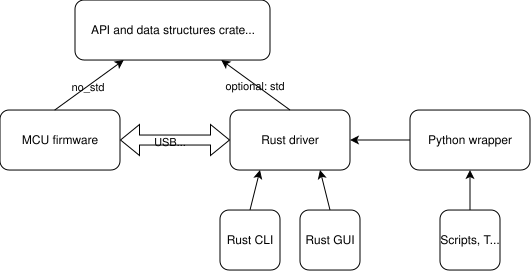

# Folder structure

An API is shared by the device and every host program that talks to it, so it lives in a crate of its own:

- **`my_device_api`**: the API trait and its data types, nothing else. Used by the firmware and the host, so it must
  build for `no_std`, with an optional `std` feature for owned types (see `examples/blinky_api`).
- **Firmware**: depends on the API crate and implements the server. WireWeaver generates the serdes and dispatch
  code, the firmware writes the handlers (see `examples_mcu/`).
- **Rust driver** (`my_device`): depends on the API crate with `std`. WireWeaver generates the client; a
  hand-written, higher-level driver can sit on top of it (see `examples/blinky`).
- **Applications**: CLIs, GUIs, test benches and scripts depend on the Rust driver. A typed Python package wraps the
  Rust driver with PyO3 (see `examples/blinky_py`); for quick scripts without generated code, the
  [Python](../python.md) module and the [`ww` CLI](../cli.md) build the API at runtime from what the device sends.

The [wire_weaver_template](https://github.com/vhrdtech/wire_weaver_template) repository has this shape ready to copy.

## The API crate's name and version

The name of the API crate (from `Cargo.toml`) identifies the API worldwide (it goes into `ww_version::FullVersion`,
the generated `<ROOT_TRAIT>_FULL_GID` constant), so publish it to crates.io for an open-source project, or pick a
name unique enough for internal use.

Its version is checked on every connection: a host and a device with compatible versions talk, others are told
apart before the first call, and your code can read the device's version to show a proper message when it meets an
older or newer firmware. Normal [SemVer rules](https://semver.org) apply, what counts as a breaking change is in the
[evolution rules](../evolution/rules.md). More in [Versioning](versioning.md).
