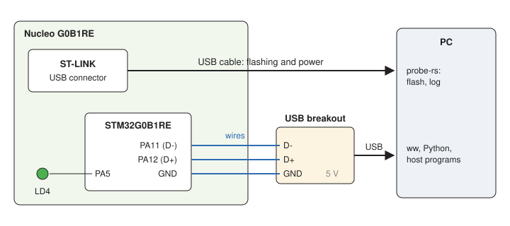

# On a real board

This chapter runs blinky on a microcontroller. The board is a Nucleo G0B1RE, a development board with an STM32G0B1RE
from ST: an Arm Cortex-M0+ with 512 KiB of flash and 144 KiB of RAM. The firmware serves the same API as the
simulated device over USB, with the same handlers. Only the LED and the transport change.

## What you need

- A Nucleo G0B1RE and a USB cable for its ST-LINK connector, which flashes the firmware and powers the board.
- A USB breakout board with a second cable. The Nucleo-64 has no USB connector for the microcontroller itself, so the
  breakout wires its USB pins to the PC.
- [probe-rs](https://probe.rs), the tool that flashes the firmware through the ST-LINK.
- The Rust target of the Cortex-M0+: `rustup target add thumbv6m-none-eabi`.

## Wiring

The STM32G0B1's USB pins are PA11 (D-) and PA12 (D+). The Nucleo brings every pin of the chip out to its two ST
morpho headers, CN7 and CN10; the pinout figure of the board's user manual, UM2324, shows where PA11 and PA12 are.
Connect the breakout's D-, D+ and GND to them, and leave its 5 V unconnected: the ST-LINK cable powers the board.



The green user LED LD4 is on PA5. The firmware drives it, so you see each call.

## The firmware

The firmware is one file, [`examples_mcu/nucleo_g0b1re/src/bin/usb_blinky.rs`]. It gives `blinky_device` the
board's LED, starts USB, and runs the same `serve` loop as the simulated device. First, the LED:

```rust
--8<-- "examples_mcu/nucleo_g0b1re/src/bin/usb_blinky.rs:led"
```

`BoardLed` implements the `Led` trait of `blinky_device` on the pin PA5. The simulated device printed a line here;
the firmware sets the pin.

A microcontroller has no heap to put the device in, and its stack is small. So the firmware keeps the LED and the
device in `static` cells, set up in place once at start:

```rust
--8<-- "examples_mcu/nucleo_g0b1re/src/bin/usb_blinky.rs:device"
```

Then USB. `usb_init` from `wire_weaver_usb_embassy` sets up the USB device and the WireWeaver server on it, each
run by a task of its own:

```rust
--8<-- "examples_mcu/nucleo_g0b1re/src/bin/usb_blinky.rs:usb"
```

The USB device names itself with descriptors that a host reads without opening it. The product is
`Nucleo G0B1RE blinky`, and the serial number is the chip's unique ID. The API ID tells the host which API the
firmware serves, here with a label, `Nucleo on the desk`, that a user would normally keep in flash.

The server's task is the simulated device's loop. It never stops, so it gets a future that never resolves:

```rust
--8<-- "examples_mcu/nucleo_g0b1re/src/bin/usb_blinky.rs:task"
```

The handlers are not in this file at all. They are the ones `blinky_device` holds, which the previous chapters ran
on the PC.

## Flashing

Plug in the ST-LINK cable, then build the firmware in `examples_mcu/nucleo_g0b1re` and flash it with probe-rs:

```sh
cd examples_mcu/nucleo_g0b1re
cargo build --release --bin nucleo-g0b1re-usb-blinky --features usb
probe-rs run --chip STM32G0B1RETx target/thumbv6m-none-eabi/release/nucleo-g0b1re-usb-blinky
```

`probe-rs run` flashes the firmware, starts it and shows its log until you press Ctrl+C; the firmware keeps running
after that. Then plug in the breakout's cable. The PC finds a new USB device, `Nucleo G0B1RE blinky`, with the
vendor ID `c0de` and the product ID `cafe`.

On Linux, opening a USB device needs permission to its file in `/dev/bus/usb`. `ww udev` prints a udev rule that
gives it; save the rule in `/etc/udev/rules.d/` and plug the board in again.

## Calling the board

The host program of the previous chapters connects over USB with `--usb`. It uses the client's default
configuration, which looks for the vendor and product IDs of blinky's firmware:

```sh
cargo run -p blinky --example blinky_host -- --usb
```

LD4 flashes on, off and on again, and the program prints the same lines as against the simulated device. Only
the count differs: the board counts its own blinks since it started.

The command line tool reaches the board too, with no address at all: with one WireWeaver device on USB, it uses
that one. This transcript is from a Nucleo G0B1RE running this firmware:

```ww
--8<-- "docs/generated/blinky/board/nucleo_g0b1re_list.txt"
--8<-- "docs/generated/blinky/board/nucleo_g0b1re_ww.txt"
```

`ww list` reads the USB descriptors without opening the device: the product, the serial number, the API with its
version and hash, and the label. `ww introspect` opens the device and prints its API. The tree is the same as the
simulated device's, since both run `blinky_device`. `ww call` calls the methods on the board, whose count includes
the blinks of earlier runs. [From the command line](command_line.md) explains each command.

## Where to go next

- [From the command line](command_line.md) finds, reads and calls a device with `ww`.
- [USB](../transport/usb.md) covers the USB transport on both sides: the host's filters, the device's descriptors
  and its timings.
- The `examples_mcu/rp2` firmware serves the same API on a Raspberry Pi Pico 2.
