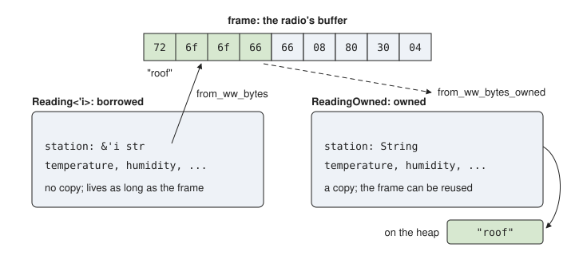

# Borrowed and owned

The sensor node and the gateway read the same bytes, but they need different things from the value they get. The
node is a microcontroller without an allocator, and the gateway is a PC that keeps every reading for a day. This
chapter shows the two kinds of type `#[derive_shrink_wrap]` makes for these two cases, and how to choose between
them.

## Two kinds of type

A [[borrowed]] type points into the bytes it was read from. Reading one copies nothing and allocates nothing, so it
works in firmware without a heap. The price is the lifetime: the value lives only as long as the buffer it borrows.
`Reading<'i>` of the [previous chapter](types_on_the_wire.md) is borrowed, and its `station: &'i str` points into the
frame.

An [[owned]] type copies its data out of the buffer into memory of its own: a `String` instead of a `&str`, a `Vec`
instead of a list in the buffer. It needs an allocator, and in exchange it lives as long as you like. The frame's
buffer can take the next message while the value stays.



Both kinds write and read exactly the same bytes. A node can write a borrowed reading, and the gateway can read it as
an owned one.

## Getting the owned twin

You don't write the owned type by hand. The directive `owned` in the attribute makes the derive generate it next to
the type you wrote, with `Owned` added to its name. Here is the reading again:

```rust
--8<-- "examples/sensor_packet/src/lib.rs:reading"
```

The derive generates `ReadingOwned`, with the same fields and the same derives. Each borrowed field type becomes its
owned counterpart, and every other field stays as it is:

| Field in `Reading<'i>`       | Field in `ReadingOwned` |
|------------------------------|-------------------------|
| `station: &'i str`           | `station: String`       |
| `temperature: Temperature`   | the same                |
| `humidity: Option<Humidity>` | the same                |
| `battery_low: bool`          | the same                |

A list borrowed from the buffer, `RefVec<'i, T>`, becomes `Vec<T>`, and a type of your own with a lifetime, such as
`Reading<'i>`, becomes its `ReadingOwned`. [Built-in types](built_in_types.md) introduces `RefVec`.

## Owned types behind a feature

A `String` needs an allocator, which the node's firmware doesn't have. `owned(feature = "std")` therefore generates
`ReadingOwned` only when the crate's feature `std` is on. The example crate declares it in
[`examples/sensor_packet/Cargo.toml`]:

```toml
--8<-- "examples/sensor_packet/Cargo.toml:features"
```

The firmware depends on the crate with `default-features = false` and gets only `Reading`. The gateway leaves the
default on and gets both. One definition serves both ends, so the two can't drift apart.

## Keeping a reading

The gateway reads each frame into a `ReadingOwned` and keeps it in a log:

```rust
--8<-- "examples/sensor_packet/src/radio.rs:keep"
```

`from_ww_bytes_owned` is the owned counterpart of `from_ww_bytes`, and `to_ww_bytes_owned` writes an owned value into
a new `Vec<u8>`. The example clears the frame after the read, then prints the kept reading and writes it again:

```text
--8<-- "docs/generated/sensor_packet/radio.txt:6:7"
```

The kept reading survived the cleared frame, and it writes the same nine bytes the node sent.

## Which types the derive makes

The derive looks at the fields to tell whether the type you wrote is borrowed or owned:

| You write                                                | It is    | `borrowed` and `owned` add            |
|----------------------------------------------------------|----------|---------------------------------------|
| a type with a lifetime, such as `Reading<'i>`             | borrowed | `owned`: the twin `ReadingOwned`      |
| a type whose name ends in `Owned`, with `String` or `Vec` | owned    | `borrowed`: the twin without `Owned`  |
| a type of plain fields only, such as `NodeId`             | both     | which of the two it implements        |

A type of plain fields has nothing to borrow, so one type serves both cases. The derive can't guess which you need,
so you name both, as the example does for the number of a sensor node:

```rust
--8<-- "examples/sensor_packet/src/lib.rs:node_id"
```

A type that mixes the two kinds, such as a lifetime and a `String`, fails to compile with a message that asks you to
pick one.

## Derives go into the attribute

The usual derives, `Debug`, `PartialEq` and the rest, go into the `derive(..)` directive, not into a
`#[derive(..)]` of their own. A `#[derive(..)]` would only apply to the type you wrote, and `derive(..)` applies to
both `Reading` and `ReadingOwned`.

## Where to go next

- [Built-in types](built_in_types.md) lists the types a field can have, borrowed and owned, with their bytes.
- The [derive reference](../serdes/derive_reference.md) lists every directive of `#[derive_shrink_wrap]`.
