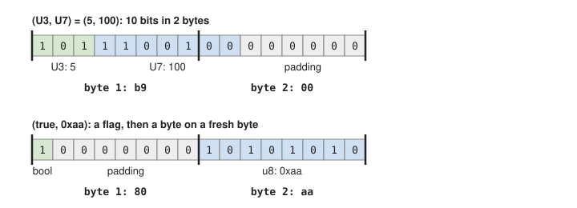

# Built-in types

A field of a `#[derive_shrink_wrap]` type can be a number, a flag, a string, a list, an `Option`, a `Result`, a
tuple, or another type of your own. This chapter goes through the types ShrinkWrap knows, what each one costs on the
wire, and which one to pick. [Structs and enums](structs_and_enums.md) then covers your own types.

## Every type at a glance

Each type starts on a bit, a nibble or a byte. The table sums up the types of this chapter:

| Type                                   | On the wire                                  | Starts on |
|----------------------------------------|----------------------------------------------|-----------|
| `bool`                                 | 1 bit                                        | a bit     |
| `U1` to `U64`, `I2` to `I64`           | exactly that many bits                       | a bit     |
| `Nibble`                               | 4 bits                                       | a nibble  |
| `u8` to `u128`, `i8` to `i128`         | 1 to 16 bytes, low byte first                | a byte    |
| `f32`, `f64`                           | 4 or 8 bytes, IEEE 754, low byte first       | a byte    |
| `UNib32`                               | 1 to 11 nibbles, small values short          | a nibble  |
| `&str`, `String`                       | UTF-8 bytes, length at the back              | a byte    |
| `RefVec<'i, T>`, `Vec<T>`              | the elements, count at the back              | a byte    |
| `[T; N]`                               | the elements, no count                       | as `T`    |
| `MaxLen<T, N>`                         | the same as `T`                              | as `T`    |
| `Option<T>`, `Result<T, E>`            | a 1-bit flag, then the value                 | a bit     |
| tuples, `()`                           | the elements one after another               | as the elements |

The sections below show real bytes for each group. The test `book_output_built_in_types` in
[`examples/sensor_packet/tests/it/book.rs`] writes each value on its own with `to_ww_bytes` and fills the tables.

## Flags and bit-sized numbers

A `bool` takes one bit. ShrinkWrap packs bit-sized values one after another, so eight flags fit in one byte.
`U1` to `U64` and `I2` to `I64` are integers of exactly that many bits: a value that never exceeds 5 fits a `U3`. Build
one with `U3::new(5)`, which returns `None` for a value that needs more bits.

--8<-- "docs/generated/sensor_packet/types_bits.md"

A value of whole bytes always starts on a fresh byte. The bits left over before it are [[padding]], and they are
zero. The figure shows the last two rows bit by bit:

`Nibble` is a 4-bit value that starts on a 4-bit boundary.

## Whole-byte numbers

`u8` to `u128`, `i8` to `i128`, `f32` and `f64` take their full width, start on a fresh byte, and store the low byte
first. A float is its IEEE 754 bits.

--8<-- "docs/generated/sensor_packet/types_numbers.md"

A number that has a unit, such as a temperature or a time, is a `Fixed` or a `Point` from `ww_si`, as the sensor
packet's `Temperature` is. On the wire it is its plain number. [Numbers that know their unit](../std_library/ww_si.md)
explains them.

## Numbers that are usually small

A number that is usually small but sometimes large can take a variable-length type. `UNib32` stores a `u32` in
nibbles, three bits of the number per nibble, so 0 to 7 take half a byte. ShrinkWrap stores its own lengths this way.

--8<-- "docs/generated/sensor_packet/types_varint.md"

`UVlq32` and `UVlq64` do the same in whole bytes, seven bits of the number per byte.

## Strings and lists

Strings, lists and arrays differ in where their length goes:

- A string is its UTF-8 bytes, with its length at the back of the message.
- A list is its elements one after another, with the number of elements at the back.
- An array `[T; N]` has a length that never changes, so its bytes are only the elements.

Bytes that are not valid UTF-8 fail to read as a string, with the error `MalformedUtf8`.

--8<-- "docs/generated/sensor_packet/types_text.md"

Each string and list has a borrowed and an owned form, as [Borrowed and owned](borrowed_and_owned.md) explains:

| What        | Borrowed: no allocator   | Owned: needs `std` |
|-------------|--------------------------|--------------------|
| a string    | `&'i str`                | `String`           |
| a list      | `RefVec<'i, T>`          | `Vec<T>`           |

A `RefVec` read from a buffer points into it and decodes each element as you iterate. To write one, make it from a
slice: `RefVec::new_bytes(&[1, 2, 3])` for bytes, or `RefVec::Slice { slice: &items }` for any elements.

## Strings and lists with a maximum

`MaxLen<T, N>` wraps a string or a list and allows at most `N` elements, or `N` bytes for a string. A sensor's name
of at most 8 bytes is a `MaxLen<&'i str, 8>`. Its bytes are those of the plain string, as the last row of the table
above shows, so the maximum costs nothing on the wire.

The maximum is checked at both ends:

- `MaxLen::new` refuses a value that is too long.
- Reading a value that is too long from bytes fails with the error `MaxLenExceeded`.
- A value is never cut to fit.

## `Option` and `Result`

An `Option<T>` is a one-bit flag, 1 for `Some`, followed by the value when there is one. A `Result<T, E>` is the
same, with 1 for `Ok` followed by the `T`, and 0 for `Err` followed by the `E`.

--8<-- "docs/generated/sensor_packet/types_option.md"

The sensor packet's `humidity` is an `Option`, and its flag is the bit before the padding in
[the layout of a reading](types_on_the_wire.md#where-each-bit-goes).

## Tuples and `()`

A tuple of 2 to 8 elements is its elements one after another, as if they were the fields of a struct. `Range<T>` and
`RangeInclusive<T>` are written the same way, as their two ends. `()` takes no bytes at all.

--8<-- "docs/generated/sensor_packet/types_tuples.md"

## Types ShrinkWrap doesn't have

Two kinds of Rust type can't be fields. Each has a stand-in that goes on the wire:

| Rust type                  | Use instead                                    |
|----------------------------|------------------------------------------------|
| `char`                     | a `&str` of one character, or its code as `u32` |
| `HashMap`, `BTreeMap`      | a list of pairs: `RefVec<'i, (K, V)>` or `Vec<(K, V)>` |

## Where to go next

- [Structs and enums](structs_and_enums.md) puts these types together into your own types.
- [Special types](../serdes/special_types.md) covers types for particular jobs: owned strings without an allocator,
  compressed series of numbers, and values that bound their own size.
