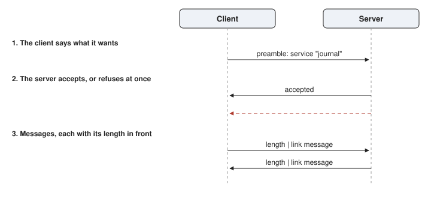

# Serial lines and other byte streams

A *byte stream* is an ordered sequence of bytes that arrives complete and unchanged. A TCP connection is one, and so
are a pipe and the standard input and output of a command. WireWeaver runs over any such stream. A client opens it and talks to a *host
server*, a program on a PC that serves one or several APIs.

This is a transport for programs, not for boards. A board serves its API over [USB](usb.md), [UDP](udp.md),
[WebSocket](websocket.md) or [RTT](rtt.md). This
chapter shows how a client reaches such a server, and why a serial line is not a byte stream in this sense.

## Reaching a host server

The client's config has three byte-stream targets, and one option that chooses the API:

| Config method | Connects to |
|---|---|
| `tcp("host:7700")` | A TCP server. |
| `command(program, args)` | A command that the client starts for the connection, over the command's input and output. |
| `stream(opener)` | A stream that your program opens, as a futures-io `AsyncRead` and `AsyncWrite`. |
| `service(name)` | Next to any of the above: the service `name` instead of the server's default API. |

The three targets need the `byte_stream` feature of `wire_weaver_client`. The example
[`examples/blinky/examples/byte_stream.rs`] uses the first two. A TCP server is selected by its address:

```rust
--8<-- "examples/blinky/examples/byte_stream.rs:tcp"
```

A command is started for every connection and killed when the connection ends. Running a server through `ssh`
reaches a service on another machine without opening a port, and `ssh` does the authentication:

```rust
--8<-- "examples/blinky/examples/byte_stream.rs:command"
```

The example runs any command that you give it. Here `blinky-service` stands for a host server of your own on the
machine `nas`:

```sh
cargo run -p blinky --features byte_stream --example blinky_byte_stream -- command ssh nas blinky-service --stdio
```

The command's error output goes to the client's, so the server's logs and the prompts of `ssh` stay visible.

## What goes over the stream

The client connects first, and the server answers at once, so a refusal is an error immediately and not a timeout. The
figure shows the three steps.



After the preamble, every message of the [link layer](../transport/ww_link.md) has its length in front. The stream is trusted to be reliable, so there is no checksum. One lost or changed byte puts the reader out of step,
and the connection ends. That is right for TCP, pipes and QUIC, which never lose a byte. The server's side of this is
described in [Host server](../api/host_server.md#byte-streams).

## Why a serial line is different

A UART looks like a byte stream, and it is not a reliable one. A noisy wire flips bits and drops bytes. A receiver
that starts in the middle of a message can't tell where the next one begins.

Such a line needs a framing that resynchronizes after an error and checks every frame with a checksum. WireWeaver's
`ww_framer` has the framing, but there is no UART medium that uses it yet. You can't connect a client to a board over
a bare serial line today.

What you can do today is bridge a UART through an API. The standard library's [`ww_uart`](../std_library/ww_uart.md)
serves a board's serial port to the host through an API. It works over any of the transports above, and reaches a
serial device that sits behind a board.

## Security

A byte-stream server takes anyone who can reach the stream. On a local socket, only the same user can. TCP has no
authentication or encryption yet, so bind a TCP listener to a trusted network only, or reach the server through `ssh`
with `command()`.

## Where to go next

[Byte streams in depth](../transport/byte_streams.md) covers the framing options of the listener and what a handler
learns about its peer.
