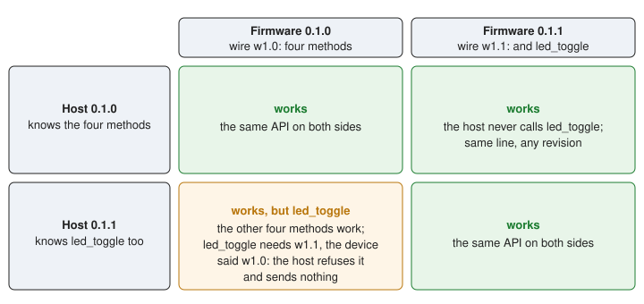

# Changing your API

Firmware stays in the field for years. The programs that talk to it are updated whenever someone feels like it. So
every version of your API meets versions that are older and newer than itself. This chapter changes the blinky API
by one method, `led_toggle`, in a way that keeps all of them talking. It then lets the [[evolution checker]] confirm
that the change is safe and say which versions to write.

The chapter uses the blinky example from [A first device](../api/overview.md). Its first release is the crate
`blinky_api` 0.1.0, in [`examples/blinky_api/Cargo.toml`]. The changed API is the same crate at version 0.1.1, in
[`examples/blinky_api_evolved/Cargo.toml`]. The repository keeps both side by side, so that old and new firmware and
hosts can meet in one test. In your own project, you change the API crate in place.

## Two kinds of break

A change to an API crate can break two different things. The **wire** breaks when bytes that one version writes
can't be read by the other. Such a break reaches devices that are already deployed, and no `cargo update` fixes
it. **Rust code** breaks when a program no longer compiles against the new crate. The compiler finds that break
before anything ships.

A change can break one without the other. Renaming a field breaks Rust code and not a single byte. Widening a field
from `u8` to `u16` compiles everywhere and breaks the wire, as [Evolving types](../serdes/derive.md#evolving-types)
shows byte by byte. This chapter avoids both.

## Add, don't change

The safe way to change an API is to add things, and to say in which version each one arrived. Here is the blinky
API after the change:

```rust
--8<-- "examples/blinky_api_evolved/src/lib.rs:root"
```

`led_toggle` comes last in its trait, after the two methods that were there before. `#[since = "w1.1"]` names the
[[wire version]] that adds it: line 1, revision 1. The host reads this attribute to decide whether a device has the
method before it calls it.

Most changes you will want are additions like this one. You can add a method, a property, a stream, a type, a field
at the end of a struct with a default, or a variant at the end of an enum. Removing, reordering or renaming something
that is already deployed is a break, and so is changing its type.
[What can change](../evolution/rules.md) lists every case.

## Two versions in Cargo.toml

Every API crate carries two versions, one for each kind of break. The crate version is the one Cargo knows, and it
follows SemVer for Rust code:

```toml
--8<-- "examples/blinky_api_evolved/Cargo.toml:version"
```

The wire version sits in the crate's WireWeaver metadata:

```toml
--8<-- "examples/blinky_api_evolved/Cargo.toml:wire"
```

`w1.1` reads "line 1, revision 1". A device and a host on the same [[wire line]] always connect, whatever their
revisions. An addition such as `led_toggle` bumps the revision, from `w1.0` to `w1.1`. A change that breaks the
wire starts a new line, `w2.0`, and a device and a host on different lines refuse each other with a clear message.
A new API starts on `w0.0`, the [design line](../evolution/versions.md#w0-the-design-line), where every change is
allowed; its first release moves to `w1.0`.

The crate version moves by Cargo's rules. An addition bumps the compatible position, here the patch: 0.1.0 becomes
0.1.1. A change that breaks Rust code bumps the breaking position, which is the minor before 1.0.

## The firmware's new handler

The new firmware serves `led_toggle` with one more [[handler]], next to the two it already had. It flips the LED
that `led_on` and `led_off` set:

```rust
--8<-- "examples/blinky_evolved/src/device.rs:toggle"
```

Firmware that was flashed before the change has no such handler, and nothing in it changes. The interesting
question is what happens when the new host meets that old firmware.

## Old and new together

There are two hosts and two firmware versions, so four pairs. The figure shows what each pair can do.



Three pairs work without a second thought: the API on both sides is the same, or the host doesn't know the new
method at all. The fourth pair needs care. The new host knows `led_toggle`, and the old firmware doesn't have it.

When a host connects, the device tells it its wire version, `w1.0` for the old firmware. Before each call, the host
compares the method's `#[since]` with that version. `led_toggle` needs `w1.1`, so the host refuses the call itself
and sends nothing. Your program gets an error it can handle, as here:

```rust
--8<-- "examples/blinky_evolved/tests/it/book.rs:toggle"
```

The test `book_output_versions` in [`examples/blinky_evolved/tests/it/book.rs`] runs every pair: each host turns the
LED on, and the new host then tries `led_toggle`. It serves both firmware versions on your PC, in the test's own
process. This is what it prints:

```text
--8<-- "docs/generated/blinky_evolved/versions.txt"
```

The third pair shows the refused call. The LED stays on: the old firmware never saw the request. In the fourth
pair, `led_toggle` turns the LED off again.

## Let the checker decide

You don't have to remember which change needs which version. The [[evolution checker]] compares the API with a
[[snapshot]] of an earlier version and tells you. A snapshot is a file in the crate's `api_snapshots/` folder that
describes the API as it was at one version.

`ww api check` runs the checker on an API crate. Here it compares the changed crate with the snapshot of 0.1.0:

```ww
--8<-- "docs/generated/blinky_evolved/check.txt"
```

The first line names the change: compatible. `needs` says which versions the change requires: wire `w1.1` and
crate 0.1.1 or later. Both are already written in `Cargo.toml`, so the last line says that the versions are bumped
enough. A change that needs more than you wrote fails the check and names the versions to write.

The checker belongs in the API crate's tests, so that `cargo test` and CI run it on every change. The API crate
takes it as a development dependency:

```toml
--8<-- "examples/blinky_api/Cargo.toml:checker"
```

The test itself is one call, in [`examples/blinky_api/tests/evolution.rs`]:

```rust
--8<-- "examples/blinky_api/tests/evolution.rs"
```

With the test in place, each new version of the API follows the same routine:

1. Bump the crate version and the wire version when you start on the next version.
2. Change the API.
3. Run the test. It fails when a change needs a bigger bump than you gave it.
4. Save the new version's snapshot with `WW_API_SAVE=1 cargo test --test evolution`, and commit `api_snapshots/`
   with the change.

## Where to go next

- [Versions and wire lines](../evolution/versions.md) explains how a device and a host decide whether they can
  talk, and how one crate holds several lines.
- [What can change](../evolution/rules.md) covers every kind of change to types and APIs.
- [The evolution checker](../evolution/checker_tool.md) covers `ww api check`, `save` and `diff`, hooks and CI.
- [A host for several wire lines](../evolution/multi_line_host.md) tells the thermometer's later life: three wire
  lines, and one host for all of them.
