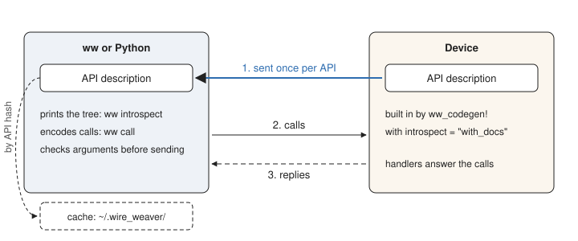

# From the command line

`ww` is WireWeaver's command line tool. It finds devices, prints a device's API, and calls its methods, all without
a host program of your own. This chapter uses it on the simulated blinky device, and the transcript in
[On a real board](board.md#calling-the-board) shows the same commands on the Nucleo G0B1RE.

## Installing ww

Install `ww` with cargo; the binary goes to `~/.cargo/bin`:

```sh
cargo install --git https://github.com/vhrdtech/ww_tools ww
```

Inside a checkout of the wire_weaver repository, `cargo ww` runs the same commands without installing them.

## How ww knows the API

`ww` was not built with blinky's API, yet it can call blinky's methods. It learns the API from the device itself.
A device built with `introspect` in its `ww_codegen!` call carries a description of its API: every item with its
name, its types and its doc comments. This is [[introspection]]. When `ww` connects, the device sends the
description, and `ww` builds the calls from it.



The description is sent once per API. `ww` keeps it in a cache in `~/.wire_weaver/`, so the next connection to a
device with the same API skips that step. The Python module of the [next chapter](python.md) works the same way.

## Finding a device

`ww list` lists the WireWeaver devices on USB. It reads the names that each device gives in its USB descriptors,
without opening the device. With the Nucleo plugged in, it prints:

```ww
--8<-- "docs/generated/blinky/board/nucleo_g0b1re_list.txt"
```

Each column tells devices apart. `API` is the API crate the firmware serves, with its version; `HASH` changes with
every change to the API. `LABEL` is a name the user gives a device, such as where it sits.

With exactly one device found, every other command uses it. With several, a flag picks one, for example
`--serial 2100` by a part of its serial number, or `--label "Nucleo on the desk"`. This choice is the device
selection, and the [command reference](../cli_reference.md) lists every flag of it.

A simulated device is not on USB, so `ww list` doesn't show it. `--websocket` gives its address instead. Start the
simulated device, if it isn't running:

```sh
cargo run -p blinky --example blinky_sim
```

## Reading the API

`ww introspect` connects to the device and prints its API as a tree:

```ww
--8<-- "docs/generated/blinky/introspect.txt"
```

The first line is the trait, with the API crate and its version. Each item follows with its number, its effects,
its signature and its doc comment. The number is the item's place in the trait, which a request uses to name it.
`[item]` after `blinks`' return type is the unit of the count.

The last lines sum the description up: how many items and types it has, how big it is in full, and how many bytes
the device sent for it. `crates` names the crates its types come from. `api hash` is the hash that `ww list`
shows. `-d` leaves the doc comments out, as in the board's transcript.

## Calling a method

`ww call` calls a method. The argument is the call as you would write it in Rust: the method's name, and its
arguments in parentheses. A method without arguments needs no parentheses. Quote a call with parentheses, so that
the shell passes it whole:

```ww
--8<-- "docs/generated/blinky/call.txt"
```

`ww call` prints what the method returns. `led_on` returns nothing, which prints as `()`. The first `set_led` says
that the LED was on, after `led_on`; the second says that it was off. `blinks` prints its count with its unit,
`item`.

`ww call` checks every argument against the method's types before it sends anything. `ww call 'set_led(1)'` fails
with an error, since `1` is not a `bool`, and the device never sees the call.

## Where to go next

- [From Python](python.md) calls the same device from a script, with the same API description.
- [Command line tool in depth](../cli.md) covers device selection, a project's `ww.toml`, and devices behind a
  debug probe.
- The [command reference](../cli_reference.md) lists every command and flag.
