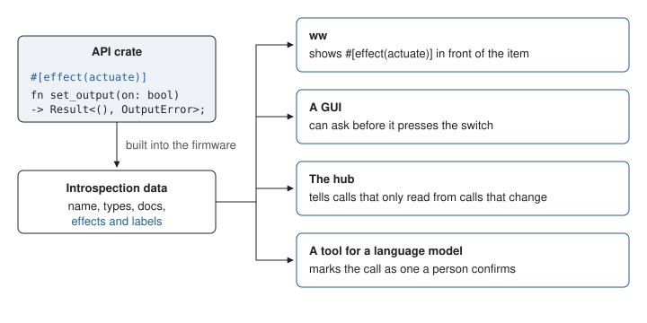

# What a call does

Some calls only look, and others change the world. Reading the bench supply's measured current is harmless.
Switching on its output puts voltage on whatever is connected to the terminals. A person at a GUI, a test script
and a language model driving the device all need to know the difference before they press anything. WireWeaver
lets the API say it, item by item, with [[effects]]. A [[label]] adds the name a person uses on the bench, such as
"CH1". This chapter marks the bench supply with both and shows where they appear.

The chapter continues the bench supply of [Errors](errors.md), in
[`examples/bench_supply_api/src/lib.rs`].

## Marking what an item does

An effect is an attribute on an item of an [[API trait]]: `#[effect(..)]` with one or more of the names below. The
bench supply's `Channel` trait marks itself `#[effect(edit)]`, and its switch `#[effect(actuate)]`:

```rust
--8<-- "examples/bench_supply_api/src/lib.rs:channel"
```

The mark on the trait is the default for every item of that trait. The mark on an item replaces it. Writing the
limits therefore has the effect `edit`, and calling `set_output` has the effect `actuate`.

| Effect        | What the call does                                                                   |
|---------------|---------------------------------------------------------------------------------------|
| `read`        | changes nothing                                                                       |
| `edit`        | changes state that can be undone or overwritten: a limit, a mode, a setpoint          |
| `persist`     | writes non-volatile memory: the change survives a reboot and wears the flash          |
| `destructive` | loses data: an erase, a cleared log, a factory reset                                  |
| `permanent`   | changes the hardware for good: fuses, one-time programmable memory, readout protection |
| `outbound`    | reaches outside the system: sends a frame on a bus, publishes a message               |
| `actuate`     | switches power or outputs, or moves something: a rail, a relay, a motor, an LED       |
| `reset`       | reboots the device or drops the link                                                  |
| `job`         | starts work that outlives the call: a capture, a scan, an update                      |

Pick every effect that applies. Saving a setting to flash is `persist`, and a factory reset is
`persist, destructive`.

## Which items need one

Every method, every writable property and every [[sink]] needs an effect, of its own or from its trait. An item
without one fails to build, and the error names the item. A forgotten mark is therefore caught at once, not in the
field.

Reads need none. Reading a property and opening a stream are `read` by their kind, so `measured` and `output_on`
carry no mark. A `read` on a method is a promise of the API's author, and nothing checks it. A method whose call
empties a buffer is no `read`: it changes what the next call returns.

## Naming what a person sees

The bench supply's outputs are channels 0 and 1 on the wire. On the front panel they are "CH1" and "CH2". The root
trait gives each element of the `channel` array its label:

```rust
--8<-- "examples/bench_supply_api/src/lib.rs:label"
```

An array takes one label per element, by index. Any other item takes one. A label changes no handler and no request
or reply. Tools show it beside the item, and an error that names a resource names it by its label.

## Who reads them

Effects and labels travel to the host in the device's [[introspection]] data, beside each item's name, types and
doc comment. Every tool reads them from there, without knowing the API in advance.



`ww introspect` shows them in front of each item:

```ww
--8<-- "docs/generated/bench_supply/introspect.txt"
```

The label stands in front of `channel[]`. The limits show `edit`, and `set_output` shows `actuate`. `measured` and
`output_on` show no mark, because a read changes nothing. `ww info --effects` lists the same marks grouped by
effect.

The other readers act on them:

- A GUI can press `read` items freely, and ask before an `actuate` or a `destructive` one.
- The [[hub]], which shares one device between several programs, treats a `read` method like a property read. Such
  a call goes through even while another program holds the resource.
- A tool that offers the device to a language model marks each call as read-only or as one a person confirms.

## Changing effects later

Effects and labels are not part of the [[wire format]]. Adding, changing or removing one leaves every byte the same,
so old hosts and old firmware keep working together. Only the API's hash changes, as it does for a doc comment, and
`ww api check` reports the change as compatible.

## Where to go next

- [A test bench in Python](test_bench.md) drives the bench supply from pytest.
- [Metadata](../api/metadata.md) covers the rest: claims that give one program a resource to itself, the
  pins a resource uses, and how effects map to the annotations of the Model Context Protocol.
