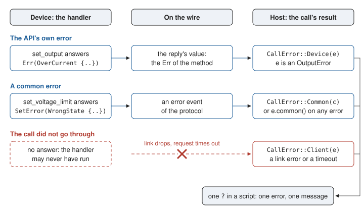

# Errors

A lab instrument has to say no. A bench supply must not switch on an output that would push more current into the
load than its limit allows, and a test script that drives it must learn why it refused. This chapter gives the
bench supply an error type of its own, returns it from the device, and handles it in Rust, in `ww` and in Python. It
also shows the [[common errors]] that every item can return without a type of its own.

The chapter uses the bench supply example in three crates. `bench_supply_api` holds the API in
[`examples/bench_supply_api/src/lib.rs`], and `bench_supply` holds the device simulated on your PC, in
[`examples/bench_supply/src/lib.rs`], and the host programs. Start the simulated device in a terminal of its own,
and leave it running while you read:

```sh
cargo run -p bench_supply --example bench_supply_sim
```

It prints `bench supply at ws://127.0.0.1:8081/ww`, the address the host programs below connect to.

## The bench supply

The bench supply has two output channels. Its root trait holds an [[array]] of them, as the thermometer holds its
inputs in [Channels](channels.md):

```rust
--8<-- "examples/bench_supply_api/src/lib.rs:root"
```

Each channel has a voltage limit and a current limit, what it measures at its terminals, and a switch for its
output:

```rust
--8<-- "examples/bench_supply_api/src/lib.rs:channel"
```

The simulated device loads each output with a fixed resistor: 10 Ω on the first channel and 2 Ω on the second. With
the output on, the load draws the voltage limit divided by that resistance. `set_output(true)` refuses when that
current is above the current limit.

## Three ways a call fails

A call to a device can fail in three different ways, and a host program has to tell them apart:

- **The API's own error.** The handler ran and answered with an error that the API declares, here an
  `OutputError` from `set_output`. A script acts on it: it raises the current limit, or it reports the load as
  faulty.
- **A common error.** The handler ran and refused with one of the errors that every device shares: the device is
  busy, a resource is in use, the request is not possible in the current state. The bench supply refuses to change
  a limit while its output is on.
- **The call did not go through.** The link dropped or the request timed out. The host doesn't know whether the
  handler ran.

The figure follows each kind from the device to the host program.



The first two travel differently on the wire. The API's own error is part of the method's return value, a normal
value of its `Result`. A common error is an error event of the protocol, so it needs no place in the API's types.
The host's generated code turns all three into one error type, so a script handles them with a single `?`.

## Declaring the API's own errors

`set_output` returns `Result<(), OutputError>`. `OutputError` is an enum with one variant per reason to refuse:

```rust
--8<-- "examples/bench_supply_api/src/lib.rs:error"
```

It is an ordinary type of the [[wire format]], with `#[derive_shrink_wrap]` like any struct or enum in
[Structs and enums](structs_and_enums.md). `ww_repr = u4` puts the variant number into four bits, room for 16
variants. A variant can carry fields: `OverCurrent` says how much the load would draw.

The `display` directive writes the error's message from the doc comment of each variant. It fills `{would_draw}`
with the field's value and drops the final period, as Rust error messages go. A host then prints the error without
a hand-written `Display`. On the device the message code is never called, and the linker drops it.

The last line, `ww_api::api_error!(OutputError)`, lets a handler use `OutputError` as an error of the API. Write
one such line for each error enum. Keep one error enum per crate, so that device code shares its helpers and a
caller converts it in one place.

An error enum may grow. A later firmware can add a variant that an older host has never heard of. The derive
therefore adds a variant `Unknown(u32)` that catches any variant number the reader doesn't know, so the older host
still decodes the reply. [Errors in depth](../api/errors.md#devices-and-hosts-of-different-versions) explains when it
is added.

## Returning an error from a handler

A [[handler]] of a method that returns `Result<T, E>` returns `Result<T, wire_weaver::Error<'_, E>>`. That
`wire_weaver::Error` is either `Api(e)`, an error of the API, or `Common(c)`, a common error. `set_output`'s handler
in the simulated device checks both refusals before it switches the output on:

```rust
--8<-- "examples/bench_supply/src/lib.rs:set_output"
```

`OutputError::NoVoltageSet.into()` turns the API's error into `wire_weaver::Error::Api`, through the `api_error!`
line. `Ready(..)` answers the call at once, as in [Methods](methods.md). Turning the output off never fails, and the
handler tells the observers of `output_on` and `measured` that their values changed.

A common error needs no declaration. The limits' write handlers return one while the output is on:

```rust
--8<-- "examples/bench_supply/src/lib.rs:voltage_limit"
```

`SetError(..)` refuses a write, as [Properties](properties.md#serving-a-property) explains. `WrongState` is one of
the nine common errors, and its `reason` is a string of at most 64 bytes. [Common errors](../std_library/ww_error.md)
lists all nine with their messages. Pick a common error when a caller has nothing specific to do about the case,
and a variant of the API's own enum when it has.

## Handling errors on the host

The generated [[client]] answers `set_output(..).call()` with `Result<(), CallError<OutputError>>`. A
[`CallError`][wire_weaver_client::CallError] holds one of the four outcomes:

```rust
--8<-- "wire_weaver_client/src/error.rs:call_error"
```

`Unimplemented` is the fourth case: the device has no code for the item at all. A device built from a scaffold
answers it until its handlers are written.

The host program [`examples/bench_supply/examples/errors.rs`] makes the first channel refuse in each way. To act on
one case, match it. Here the script tells the user what to do when no voltage is set, and passes on every other
error:

```rust
--8<-- "examples/bench_supply/examples/errors.rs:match"
```

A variant's fields are values like any other. With 30 V on 10 Ω the load would draw 3 A, above the 1 A limit:

```rust
--8<-- "examples/bench_supply/examples/errors.rs:would_draw"
```

A write to a property without an error type of its own returns `Result<(), wire_weaver_client::Error>`. Its
`common()` gives the common error the device refused with, if there was one. `CallError` has the same `common()`,
so generic code handles `Busy` or `Timeout` without knowing the API:

```rust
--8<-- "examples/bench_supply/examples/errors.rs:common"
```

Most code doesn't match at all. `CallError` implements `std::error::Error` with the inner error's message, so `?`
passes it to an `anyhow` or `thiserror` error like any other. The function `switch_on` sets up a channel and
switches it on with one `?` per call:

```rust
--8<-- "examples/bench_supply/examples/errors.rs:switch_on"
```

On the second channel, 3.3 V on 2 Ω would draw 1.65 A, above the 0.5 A limit. The caller prints the error that `?`
passed on:

```rust
--8<-- "examples/bench_supply/examples/errors.rs:question_mark"
```

Run the program in a second terminal, while the simulated device runs in the first. It prints one line per refusal:

```console
--8<-- "docs/generated/bench_supply/errors.txt"
```

The messages are the doc comments of `OutputError` and `CommonError`, with the fields filled in.

## From the command line

`ww call` prints a method's `Err` and a common error as an error. A refused write never changes the value:

```ww
--8<-- "docs/generated/bench_supply/call_errors.txt"
```

`Err(NoVoltageSet)` is the variant of the API's own error. The common error comes with its message and the place
in the device's generated code that sent it: site 2 is the handler.

## From Python

The `wire_weaver` Python module raises `ww.RemoteError` for both kinds. For the API's own error, the exception's
`value` holds the variant, and its message names the method and gives the variant's message:

```python
--8<-- "examples/bench_supply_py/errors.py:own"
```

A variant with fields is a dictionary, as every enum value is in Python:

```python
--8<-- "examples/bench_supply_py/errors.py:fields"
```

For a common error, `value` is `None` and `common` holds the variant:

```python
--8<-- "examples/bench_supply_py/errors.py:common"
```

The whole script is [`examples/bench_supply_py/errors.py`]. With the simulated device running, it prints:

```console
--8<-- "docs/generated/bench_supply/errors_py.txt"
```

A call that does not go through raises `TimeoutError` or `ww.WireWeaverError` instead, and a value outside a type's
bounds raises `ValueError` before anything is sent.

## Where to go next

- [Common errors](../std_library/ww_error.md) lists the nine errors every device shares, with their messages and
  their bytes.
- [Errors in depth](../api/errors.md) covers the rest: the list of errors a method returns, `Unsupported` against
  `Unimplemented`, where on the device a framework error came from, and errors from devices of other versions.
- [What a call does](effects.md) marks what `set_output` does to the world, so that tools know to ask first.
