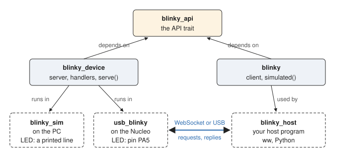

# A device on your PC

This chapter builds the smallest useful device: an LED that a host turns on and off. You write its API as a Rust
trait, serve the trait from a device simulated on your PC, and call it from a host program. No board is needed yet.
[On a real board](board.md) later runs the same code on a Nucleo G0B1RE.

The device is called blinky. Its code lives in four crates of the repository's `examples/` directory, and each
crate has one job. The figure shows them and who uses each.



| Crate | What it holds | Who uses it |
|---|---|---|
| `blinky_api` | The API trait, nothing else | the device and every host |
| `blinky_device` | The device's code: the handlers and the loop that serves them | the simulated device and the firmware |
| `blinky` | The host side, and the simulated device | host programs and tests |
| `examples_mcu/nucleo_g0b1re` | The firmware of one board | the board |

## The API trait

An [[API trait]] lists what a device offers. Blinky offers four [[methods]]: calls that the host makes and the
device answers. Here is the whole trait, from [`examples/blinky_api/src/lib.rs`]:

```rust
--8<-- "examples/blinky_api/src/lib.rs:root"
```

`#[ww_api_root]` marks the trait as the top of a device's API. Each `fn` is a method, written without a body and
without `self`. This chapter uses `led_on` and `led_off`, which take nothing and return nothing. The next chapter,
[Methods](methods.md), explains `set_led` and `blinks`.

The doc comments are part of the API. They travel to the host with it, so the command line tool and Python show
them. `#[effect(actuate)]` says that a call changes something in the physical world; [[effect]] marks like this one
tell tools what a call does, and a later chapter covers them.

The trait sits in an [[API crate]] of its own. The device and every host depend on it, so it builds for `no_std`
and depends only on `ww_api`, the crate with WireWeaver's derive macros and attributes. Its `Cargo.toml` also names
the API's wire version, which a host and a device compare when they connect:

```toml
--8<-- "examples/blinky_api/Cargo.toml:wire"
```

## The device

A trait alone does nothing. The device side needs a [[server]]: code that reads a request from the bytes that
arrive, calls your function for it, and writes the reply. WireWeaver generates the server from the trait. You write
one [[handler]] per method, a function that does the work.

Blinky's device code is the crate `blinky_device`. It is written once and runs unchanged on the PC and on a board.
What differs between the two is the LED, so the crate asks the board for one through a small trait:

```rust
--8<-- "examples/blinky_device/src/lib.rs:led"
```

The server's state is a struct. It holds the LED, whether the LED is on, and a count that the next chapter uses:

```rust
--8<-- "examples/blinky_device/src/lib.rs:state"
```

The handlers are methods of that struct, with the names of the trait's methods. `led_on` and `led_off` switch the
LED and answer at once:

```rust
--8<-- "examples/blinky_device/src/lib.rs:handlers"
```

Each handler is `async` and gets a `cx` argument, the request's context, which these handlers don't need.
`RpcResult<()>` is the answer; `Ready(())` answers now with nothing in it. The handler's signature follows from the
trait, so you don't have to write it by hand: `ww api scaffold examples/blinky_api` prints every handler's stub.

The `ww_codegen!` macro generates the server. It reads the trait from the API crate's source and implements the
dispatch on `Blinky`:

```rust
--8<-- "examples/blinky_device/src/lib.rs:codegen"
```

`server = true` asks for a server, and `no_alloc = true` for one that never allocates, as a small microcontroller
needs. `use_async = true` makes the handlers `async`. `introspect = "with_docs"` builds a description of the API,
doc comments included, into the device, so that tools can ask the device what it offers.

Last, `serve` runs the server: it waits for a request, hands it to the handlers, and sends the reply. The [[transport]],
WebSocket on the PC or USB on a board, is the `server` argument:

```rust
--8<-- "examples/blinky_device/src/lib.rs:serve"
```

## The device on your PC

A [[simulated device]] is the device code running on your PC, with something simple in place of the hardware. Blinky's
LED becomes a line of text. The example `blinky_sim` in [`examples/blinky/examples/sim.rs`] gives the device this
LED:

```rust
--8<-- "examples/blinky/examples/sim.rs:led"
```

The function `simulated` in the `blinky` crate builds the server around a WebSocket connection and runs `serve`:

```rust
--8<-- "examples/blinky/src/lib.rs:simulated"
```

Start the simulated device in a terminal of its own, and leave it running:

```sh
cargo run -p blinky --example blinky_sim
```

It prints `blinky at ws://127.0.0.1:8080/ww`, the address that host programs connect to.

## The host program

The host side is a [[client]]: a struct with one function per method of the trait. `ww_codegen!` generates it too,
this time with `client = "std_client"`. The struct holds the connection, a `Commander`, and implements `WwClient`,
which adds the functions that connect:

```rust
--8<-- "examples/blinky/src/lib.rs:client"
```

`default_config` names the device the client looks for when it gets no other address: a USB device with the vendor
and product IDs that blinky's firmware uses. The host program in [`examples/blinky/examples/host.rs`] connects to
the simulated device instead, at its WebSocket address:

```rust
--8<-- "examples/blinky/examples/host.rs:connect"
```

Each method of the trait is now a function on `device`. A call is prepared first and then sent with `.call()`;
`.await` waits for the device's answer:

```rust
--8<-- "examples/blinky/examples/host.rs:calls"
```

Run the host program in a second terminal, while the simulated device runs in the first:

```sh
cargo run -p blinky --example blinky_host
```

The device's terminal prints `LED on` and `LED off`: the two calls reached the handlers and switched the simulated
LED. The host program prints two more lines, from the methods of the next chapter.

## Where to go next

- [Methods](methods.md) adds arguments and return values, and follows a call from the host to the handler and back.
- [On a real board](board.md) runs `blinky_device` on a Nucleo G0B1RE over USB.
- [What an API can have](../api/overview.md) lists the other items of a trait: properties, streams, sinks and
  nested traits.
