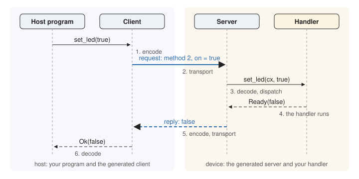

# Methods

A [[method]] is a call into the device. The host sends the arguments, the device runs the method's handler, and
the handler's return value travels back to the host. [A device on your PC](first_device.md) used two methods
without either. This chapter uses blinky's other two: `set_led` takes an argument and returns a value, and
`blinks` returns a count.

Keep the simulated device from the previous chapter running, or start it again:

```sh
cargo run -p blinky --example blinky_sim
```

## Arguments and return values

A method's arguments and its return type are written as in any Rust function. Here are the two methods in
[`examples/blinky_api/src/lib.rs`]:

```rust
--8<-- "examples/blinky_api/src/lib.rs:methods"
```

`set_led` takes one argument, `on`, and returns whether the LED was on before the call. A host that only wants to
switch the LED ignores the answer. A host that wants to restore the LED later keeps it.

`blinks` takes no argument and returns a number. Its type says what the number counts: `Fixed<Item, One, u32>` is a
`u32` on the wire, a count of items in steps of one. A bare `u32` would carry the same bytes but not their meaning.
[Numbers that know their unit](../std_library/ww_si.md) explains these types; for now, `.get()` gives the plain
`u32` back.

A method takes any number of arguments, and each can be any type the wire format carries: numbers, `bool`,
strings, lists, `Option`, and your own structs and enums, as [Your data on the wire](../serdes/shrink_wrap.md)
shows. A method that can fail returns `Result<T, E>`, as [Errors](../api/errors.md) explains.

## The handlers

The device answers each method with a handler of the same name. A handler's arguments are the method's, after
`self` and `cx`, and its return value is the method's, inside `RpcResult`:

```rust
--8<-- "examples/blinky_device/src/lib.rs:method_handlers"
```

`set_led` passes `on` to the helper `switch`, which switches the LED, counts a blink when it goes on, and returns
the state before. `blinks` returns the count it keeps. Both answer at once with `Ready`. The handler of a method
without a return value returns `RpcResult<()>`, as `led_on` does.

When the trait changes, the handlers must follow. `ww api scaffold examples/blinky_api` prints the stub of every
handler with its exact signature, so a new method's handler starts from a stub that compiles.

## The path of a call

The figure follows one call of `set_led(true)` from the host program to the handler and back. Nothing on the way
needs code of yours except the handler.



1. The client encodes the argument `true` and a request that names the method, and sends it.
2. The [[transport]], WebSocket here and USB on a board, carries the bytes to the device.
3. The server decodes the request, finds the method by its place in the trait, and decodes the argument.
4. The handler runs and returns `false`, since the LED was off.
5. The server encodes the return value into a reply, and the transport carries it back.
6. The client decodes the reply and returns `false` to the host program.

The client and the server are generated from the same trait, so the argument's and the return value's types match
on both sides. A request names the method by its place in the trait, not by its name, which keeps it short.

## Calling from the host

The client has one function per method. Each takes the method's arguments and returns a prepared call, which
`.call().await` sends. The host program in [`examples/blinky/examples/host.rs`] calls both methods and prints
their answers:

```rust
--8<-- "examples/blinky/examples/host.rs:methods"
```

`.call().await` returns a `Result`. The `Ok` value is the method's return value; an `Err` means that the call did
not go through, because the link failed or the device did not answer in time. `?` passes that error on.

Run the program while the simulated device runs:

```text
--8<-- "docs/generated/blinky/host.txt"
```

The program switches the LED on and off as before, then calls `set_led(true)`. The LED was off, so the answer is
`false`. The count is 2: the LED went on twice since the simulated device started, once from `led_on` and once from
`set_led(true)`. Run the program again and the count goes on from there, since the simulated device keeps its state
until you stop it.

`.call().await` is one of several ways to send a call. `.blocking_call()` waits without `async`, for programs that
don't use an async runtime. `.call_forget()` sends a call without waiting for an answer, for a method that returns
nothing. [Methods in depth](../api/methods.md) covers these and the rest.

## Where to go next

- [On a real board](board.md) runs the same handlers on a Nucleo G0B1RE over USB.
- [From the command line](command_line.md) calls the methods without writing a host program.
- [Methods in depth](../api/methods.md) covers arguments added in later versions, answers sent later, and the
  handler's context.
