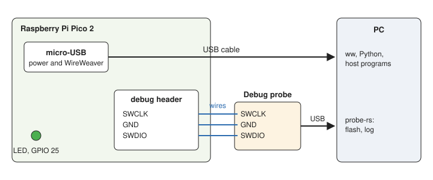

# On a Pico 2

This page runs blinky on a Raspberry Pi Pico 2, a development board with an RP2350, the microcontroller of Raspberry
Pi: two Arm Cortex-M33 cores, 520 KiB of RAM and 4 MiB of flash. It is the second board of [On a real board](board.md),
which does the same on a Nucleo G0B1RE. The firmware serves the same API as the simulated device over USB, with the
same handlers. Only the LED and the USB driver change.

## What you need

- A Pico 2 and a micro-USB cable. The Pico's USB connector reaches the microcontroller itself, so no breakout board is
  needed.
- A [[debug probe]] with its cable, for example the Raspberry Pi Debug Probe or a J-Link. The probe flashes the
  firmware and shows its log.
- [probe-rs](https://probe.rs), the tool that flashes the firmware through the probe.
- The Rust target of the Cortex-M33: `rustup target add thumbv8m.main-none-eabihf`.

## Wiring

The Pico 2 has a three-pin debug header at the short edge opposite its USB connector. Connect the probe's SWCLK,
SWDIO and GND to it. SWD, the Serial Wire Debug protocol, is how the probe talks to the chip. The probe does not
power the board: the USB cable does.



The user LED is on GPIO 25. The firmware drives it, so you see each call.

## The firmware

The firmware is one file, [`examples_mcu/rp2/src/bin/usb_blinky.rs`]. It is the Nucleo's firmware with the board's
parts swapped, so this page only shows what differs. First, the LED:

```rust
--8<-- "examples_mcu/rp2/src/bin/usb_blinky.rs:led"
```

`BoardLed` implements the `Led` trait of `blinky_device` on GPIO 25. The device sits in `static` cells, set up in
place once at start:

```rust
--8<-- "examples_mcu/rp2/src/bin/usb_blinky.rs:device"
```

Then USB. The driver is the RP2350's, and the call to `usb_init` is the one the Nucleo makes:

```rust
--8<-- "examples_mcu/rp2/src/bin/usb_blinky.rs:usb"
```

The USB device names itself `Pico 2 blinky`, and the API ID carries the label `Pico 2 on the desk`. This firmware sets
no serial number, so `ww list` shows an empty column; with several Picos on one PC, tell them apart by the label.

The server's task is the simulated device's loop, and the handlers are the ones `blinky_device` holds:

```rust
--8<-- "examples_mcu/rp2/src/bin/usb_blinky.rs:task"
```

## Flashing

Plug in both cables, then build the firmware in `examples_mcu/rp2` and flash it with probe-rs:

```sh
cd examples_mcu/rp2
cargo build --release --bin rp2_usb_blinky --features usb
probe-rs run --chip RP235x target/thumbv8m.main-none-eabihf/release/rp2_usb_blinky
```

`probe-rs run` flashes the firmware, starts it and shows its log until you press Ctrl+C; the firmware keeps running
after that. A few seconds later the PC finds a new USB device, `Pico 2 blinky`, with the vendor ID `c0de` and the
product ID `cafe`. If the log shows `SET_CONFIGURATION: configured`, the PC has accepted it.

On Linux, opening a USB device needs permission to its file in `/dev/bus/usb`. `ww udev` prints a udev rule that
gives it; save the rule in `/etc/udev/rules.d/` and plug the board in again.

## Calling the board

The host program of the previous chapters connects over USB with `--usb`:

```sh
cargo run -p blinky --example blinky_host -- --usb
```

The LED flashes on, off and on again, and the program prints the same lines as against the simulated device. The
command line tool reaches the board too. This transcript is from a Pico 2 running this firmware:

```ww
--8<-- "docs/generated/blinky/board/pico2_list.txt"
--8<-- "docs/generated/blinky/board/pico2_ww.txt"
```

The tree is the same as the Nucleo's and the simulated device's, and so is the API hash, since all three run
`blinky_device`. `ww list` shows what this firmware put in its USB descriptors: the product, the API and the label.
The `STATE` column says whether a program already holds the device. The count of `ww call blinks` includes the
blinks of earlier runs.

## Where to go next

- [From the command line](command_line.md) finds, reads and calls a device with `ww`.
- [USB](../transport/usb.md) covers the USB transport on both sides: the host's filters, the device's descriptors and
  its timings.
