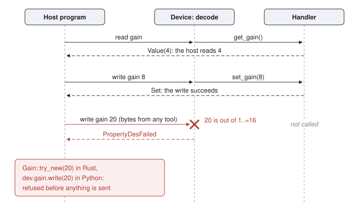

# Properties

A [[property]] is a value of a device that a host reads, writes or both. The thermometer has two at its top level:
`mode` says what its sampler does, and `gain` is the amplification of its inputs. This chapter declares both, serves
them on the device, and reads and writes them from Rust, from the command line and from Python. It also shows how a
property's type refuses a bad value before your code ever sees it.

The chapter uses the thermometer example in three crates. `thermometer_api` holds the API in
[`examples/thermometer_api/src/lib.rs`], `thermometer_device` the device code in
[`examples/thermometer_device/src/lib.rs`], and `thermometer` the host programs and a device simulated on your PC. Start the simulated device in a terminal of its
own, and leave it running while you read:

```sh
cargo run -p thermometer --example thermometer_sim
```

It prints `thermometer at ws://127.0.0.1:8080/ww`, the address the host programs below connect to.

## Declaring a property

A property is one line of an [[API trait]]: `property!(ACCESS name: Type)`. The access says what a host may do with
the value. Here is the thermometer's root trait, `Thermo`, with `mode` and `gain` in the middle:

```rust
--8<-- "examples/thermometer_api/src/lib.rs:root"
```

The access is one of three keywords. `rw` lets a host read and write the value, `ro` lets it only read, and `wo` lets
it only write. Both of the thermometer's properties are `rw`. The `+observe` after `gain`'s access lets a host
[[observe]] the value instead of reading it again and again, as [Watching a value](observing.md)
explains.

| Access | A host can                | Typical use                                      |
|--------|---------------------------|--------------------------------------------------|
| `rw`   | read and write            | a setting: a mode, a gain, a threshold           |
| `ro`   | read                      | a measured state: a button, a supply voltage     |
| `wo`   | write                     | a command with a value: a beep at a frequency    |

`ro` means read only for the host. The device changes such a value whenever it likes, for example when a button is
pressed.

## Types that carry their limits

A property's type is any type the wire format supports: a number, a `bool`, a struct or an enum. `mode` is an enum,
and every variant is a state the sampler can be in:

```rust
--8<-- "examples/thermometer_api/src/lib.rs:mode"
```

`gain` is a number from 1 to 16. Its type says so, and the API crate names that type [`Gain`]:

```rust
--8<-- "examples/thermometer_api/src/lib.rs:gain"
```

`Fixed<Ratio, One, u8, Range<1, 16>>` is a `u8` on the wire, one byte, with its meaning in the type. `Ratio` and `One`
say that the number has no unit and counts in steps of one. `Range<1, 16>` gives its [[bounds]]: the smallest and
the largest value the device accepts, both included, as [Numbers that know their unit](units.md) explains for the
thermometer's rate.

Bounds are checked every time a value is built or decoded. A value outside them can't be made in Rust, and the
device refuses one that arrives from the wire before your code runs. [The figure](#a-read-a-write-and-a-refused-write)
below shows both.

## Serving a property

The device answers reads and writes through [[handlers]], one function per read and one per write. Their names follow
the property: `get_mode` and `set_mode` for `mode`. This way of serving a property is the `get_set` [[property model]],
and the thermometer picks it for every property in its `ww_codegen!` call:

```rust
--8<-- "examples/thermometer_device/src/lib.rs:codegen"
```

The handlers of `mode` keep the value in the device's state and start or stop the sampler with it:

```rust
--8<-- "examples/thermometer_device/src/lib.rs:mode"
```

A read handler returns a [`GetResult`]. `GetResult::Value(v)` answers the read with `v`, and `GetResult::GetError(e)`
answers it with an error. A write handler gets the new value and returns a [`SetResult`]: `SetResult::Set` confirms
the write, and `SetResult::SetError(e)` refuses it. The `Mode::Unknown(_)` arm is a variant that a newer host knows
and this firmware doesn't; the sampler then stops.

The handlers of `gain` are shorter. They never check the value, because its type already did:

```rust
--8<-- "examples/thermometer_device/src/lib.rs:gain"
```

The handler doesn't tell observers about the new gain. The generated code does that after `SetResult::Set`.

## A read, a write and a refused write

The figure follows three requests for `gain` from a host program to the device. The device first decodes each
request, then calls the handler with the value.



1. A read reaches `get_gain`, which answers 4.
2. A write of 8 is decoded, reaches `set_gain`, and succeeds.
3. A write of 20 fails while the device decodes it, because 20 is outside `Range<1, 16>`. The device answers with the
   error `PropertyDesFailed`, and `set_gain` is never called.

Step 3 only happens when the bytes come from a program that doesn't know the bounds, such as a tool written for
another firmware. The clients WireWeaver generates know them, so they refuse 20 before anything is sent. The test
`the_device_refuses_a_gain_out_of_bounds` in [`examples/thermometer/tests/it/book.rs:gain_bounds`] writes the bytes
of 20 by hand to check step 3.

## Reading and writing from Rust

The host program in [`examples/thermometer/examples/read.rs`] holds a generated [[client]] of the API. For every
property it has `read_NAME()` and, when the access allows, `write_NAME(value)`. Each call is prepared first and then
sent, here with `.await`:

```rust
--8<-- "examples/thermometer/examples/read.rs:properties"
```

`Gain::bounded(8)` is for a value written in the source. In `const` code a value outside 1 to 16 fails the build,
and elsewhere it panics. `Gain::try_new(20)` is for a value that arrives at run time, from a user or a file: it
returns an error instead, so a bad gain never reaches the wire. Run the program in a second terminal, while the
simulated device runs in the first:

```sh
cargo run -p thermometer --example thermometer_read
```

After one sample it prints the lines of this section: `mode: Idle`, `gain: 8` and
`refused: 20 is out of 1..=16 (Ratio, u8)`.

## From the command line

The [`ww` command line tool](command_line.md) reads a device's API from the device itself, through [[introspection]]. `--websocket`
connects it to the simulated thermometer instead of a USB device, and `introspect -d` prints the API without its
doc comments:

```ww
--8<-- "docs/generated/thermometer/introspect.txt"
```

Each line is one item of the trait, numbered in declaration order. `mode` is item 2 and `gain` item 3. `[1..=16]`
after `gain`'s type is its bounds. `observable` marks its `+observe`.

## From Python

The `wire_weaver` Python module talks to any device without generated code. It builds the API at run time from the
device's introspection data, so every property is an attribute of the connected device:

```python
--8<-- "examples/thermometer_py/properties.py:connect"
```

`dev.mode.read()` reads a property and `dev.mode.write(value)` writes it. An enum variant without fields is its name
as a string:

```python
--8<-- "examples/thermometer_py/properties.py:mode"
```

Python checks bounds as the Rust client does. Writing 20 raises a `ValueError` before anything is sent:

```python
--8<-- "examples/thermometer_py/properties.py:gain"
```

The whole script is [`examples/thermometer_py/properties.py`]. With the simulated device running, it prints:

```console
--8<-- "docs/generated/thermometer/properties_py.txt"
```

The gain stays at 8 after the refused write: the device never saw 20.

## Where to go next

- [Watching a value](observing.md) sends a property's new values to the host as they change, as `gain` allows
  with `+observe`.
- [Properties in depth](../api/properties.md) covers the rest: a property served as a plain field, errors of a
  property's own, `const` items, and the host's timeouts and promises.
