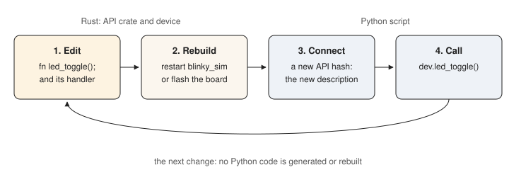

# From Python

The `wire_weaver` Python module talks to any WireWeaver device. Like `ww`, it learns the API from the device's
[[introspection]] data when it connects, so a script needs no code generated for its device. This chapter calls
blinky from a script, then changes blinky's API and calls the new method at once.

## Installing the module

The module is a wheel built from Rust with [maturin](https://www.maturin.rs). Build it from a checkout of the
[vhrdtech/ww_tools](https://github.com/vhrdtech/ww_tools) repository, which needs a Rust toolchain, and install it
into the Python environment of your scripts:

```sh
cd ww_tools/wire_weaver_wheel
uvx maturin build --release
uv pip install target/wheels/wire_weaver-*.whl
```

The wheel needs no system libraries. It reaches devices over USB, over a debug probe and over WebSocket.

## Connecting

`ww.connect` connects to one device and returns it. Its keyword arguments say which device: `websocket_url` for a
simulated device, or USB filters such as `vid_pid` for a board. The script
[`examples/blinky_dyn_py/blinky.py`] takes either:

```python
--8<-- "examples/blinky_dyn_py/blinky.py:connect"
```

Printing the device prints its API, with each method's signature and the first line of its doc comment:

```python
--8<-- "examples/blinky_dyn_py/blinky.py:tree"
```

## Calling methods

Each method of the API is a method of the device object. Arguments go in by position or by name, as with any
Python function, and the call returns what the method returns:

```python
--8<-- "examples/blinky_dyn_py/blinky.py:calls"
```

A Rust `bool` is a Python `bool`. `blinks` returns its count with the unit, as `ww call` prints it. A method that
returns nothing returns `None`.

The module checks every argument against the method's types before it sends anything. A string where the method
wants a `bool` raises a `TypeError`, and the device never sees the call:

```python
--8<-- "examples/blinky_dyn_py/blinky.py:refused"
```

With the simulated device running, `python blinky.py` prints:

```text
--8<-- "docs/generated/blinky/blinky_py.txt"
```

The first five lines are the printed device. The two `was on` lines answer the two calls of `set_led`, and the
count says that the LED went on twice. Against the board, `python blinky.py usb` prints the same lines, with the
board's own count.

## Changing the API and trying it at once

A script learns the API every time it connects. A changed API therefore needs no new Python code: rebuild the
device, run the script again, and the new item is there. This makes Python the quickest way to try a new method.



Try it with a method that toggles the LED:

1. Add `fn led_toggle();` with `#[effect(actuate)]` to `BlinkyApi` in [`examples/blinky_api/src/lib.rs`].
2. Add its handler to `Blinky` in [`examples/blinky_device/src/lib.rs`]: an `async fn led_toggle` that calls
   `self.switch(!self.on)` and answers `Ready(())`. `ww api scaffold examples/blinky_api` prints its signature.
3. Stop the simulated device with Ctrl+C and start it again with `cargo run -p blinky --example blinky_sim`, which
   builds it with the new method. For the board, build and flash the firmware as in
   [On a real board](board.md#flashing).
4. In Python, connect again and call `dev.led_toggle()`. `print(dev)` lists it with the others.

The cache files each description under its API's hash. The hash changes with the new method, so the module asks
the device for the new description. A host program in Rust needs a rebuild to get the new function; `ww` and Python don't.

[`examples/blinky_api_evolved/src/lib.rs`] holds this change, with the version attributes that let old hosts and old firmware
keep working together. [Changing your API](../evolution/overview.md) explains them.

## Where to go next

- [Python](../python.md) covers the module in full: the values of every type, properties, streams, errors and the
  interactive console.
- [`examples/blinky_py/README.md`] wraps the generated Rust client in a typed Python module instead, for a package with
  fixed signatures and editor completion.
- [What an API can have](../api/overview.md) shows the items beyond methods: properties, streams, sinks and
  nested traits.
