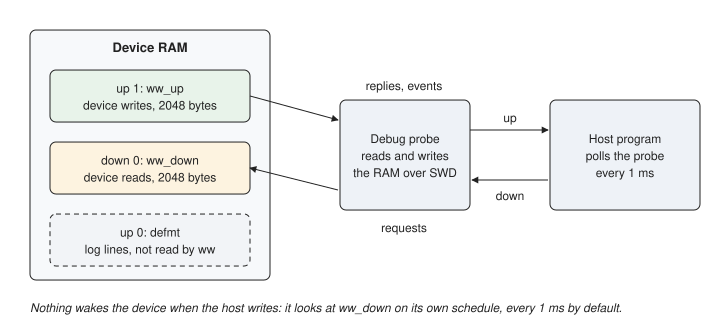

# RTT

A debug probe is already attached to a board during development, and RTT turns it into a transport. The device keeps
two ring buffers in its RAM, one for each direction, and the probe reads and writes them over its debug wires. The
board needs no USB peripheral and no wiring for a serial line. RTT also works next to `defmt` logging, which uses
another RTT channel.

Use RTT when a board has no USB to spare or when the USB code isn't written yet. It also lets you try an API on a
chip before the transport hardware exists. This chapter shows both ends: the device's firmware and the host program.

## How RTT carries messages

A [[ring buffer]] is a fixed region of memory that one side writes and the other reads, wrapping around at the end. RTT
calls a buffer that the device writes an *up channel*, and one that the device reads a *down channel*.



Neither side can wake the other. The device looks at the down channel on its own schedule, once per millisecond by
default. The host polls the probe in the same way. A call therefore takes a few milliseconds. The exact time depends
mostly on the probe and the clock of its debug wires, not on the device.

## Serving over RTT

The firmware creates the channels first. `rtt_init!` makes them in RAM and gives their names, sizes and what happens
when a channel is full. The names `ww_up` and `ww_down` are what the host looks for, so they are fixed:

```rust
--8<-- "examples_mcu/nucleo_g0b1re/src/bin/ww_rtt.rs:channels"
```

Then `rtt_server()` takes the link configuration, one up and one down channel, and a clock, and gives the same
`Server` that a USB device runs:

```rust
--8<-- "examples_mcu/nucleo_g0b1re/src/bin/ww_rtt.rs:server"
```

The complete firmware is [`examples_mcu/nucleo_g0b1re/src/bin/ww_rtt.rs`]. It serves the blinky API, the smallest
device of the book. The transport code is the same for every API, and only the generated server differs. Flash it
with `just run nucleo ww_rtt` from `examples_mcu/nucleo_g0b1re`, then stop `probe-rs run`, which holds the probe. The
firmware keeps running.

Three sizes matter:

| Size | Rule |
|---|---|
| `MAX_MESSAGE_LEN` | The longest message the device accepts and sends. The host learns it during link setup and never sends more. |
| The up channel | At least `MAX_MESSAGE_LEN + 5` bytes, better twice that, because a message that doesn't fit is skipped whole. |
| The down channel | Enough for what the host writes between two polls. |

Use `NoBlockSkip` or `NoBlockTrim` for the channels. `BlockIfFull` makes the device wait forever when no host is
reading.

## Connecting

The host reaches the device through the probe with `rtt()`. Its first argument is the chip's name in
[probe-rs](https://probe.rs), the same name that `probe-rs run --chip` takes:

```rust
--8<-- "examples/blinky/examples/rtt.rs:connect"
```

The second argument of `rtt()` is the clock of the debug wires, and `None` keeps the probe's default. A filter such as
`serial_contains()` after `rtt()` picks one of several probes. The example is
[`examples/blinky/examples/rtt.rs`]; run it with the `rtt` feature while the probe is free:

```sh
cargo run -p blinky --features rtt --example blinky_rtt -- --chip STM32G0B1RETx
```

Attaching doesn't reset the chip, so a running firmware is attached to as it is. The host scans the chip's RAM for the
RTT control block, which takes a noticeable time on a chip with a lot of RAM. Through a Nucleo's ST-LINK, 144 KiB
take about 1.5 seconds. The firmware's ELF file tells the host where the block is. With `--elf`, which becomes `rtt_elf()`,
attaching takes tens of milliseconds instead.

## Limits

- A probe can only be opened once. While the host holds it, nothing else can: not `probe-rs run`, and not a debugger.
  The `defmt` logs on the other channel can't be read during that time.
- A message that is larger than the other side's buffer breaks the stream until the link is set up again. Both sides
  tell each other their longest message, so this only happens through a bug.
- RTT has no notion of a connection. A host that is gone shows as an up channel that stays full. The link's peer
  timeout, 10 seconds without a message, ends the session in any case.

## Where to go next

[RTT in depth](../transport/rtt.md) covers the framing in stream mode, the cost in flash and instructions, and the
timing settings.
