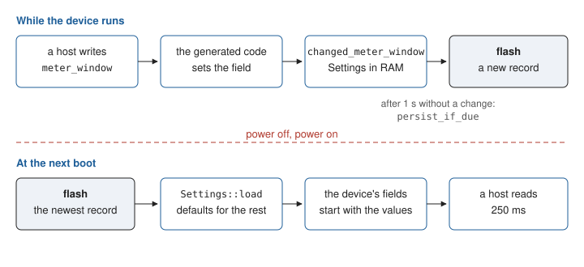

# Settings that survive a reboot

Most devices keep a few values that a user sets once: a calibration, a name, the averaging window of a sensor. They
must still be there after the power was off. This chapter keeps two such settings in flash with `ww_settings`,
serves them as ordinary properties, and reboots the device to show that they survive.

The chapter uses the settings example. `settings_api` holds the API in [`examples/settings_api/src/lib.rs`], and
`settings` the device on a simulated flash in [`examples/settings/src/lib.rs`]. The same API runs on a Nucleo
G0B1RE, with the settings in the chip's own flash.

## Settings are properties

To a host, a setting is a [[property]] like any other. The settings example has two:

```rust
--8<-- "examples/settings_api/src/lib.rs:api"
```

`meter_window` is a time from 10 ms to 10 s, in steps of 1 ms, as [Numbers that know their unit](units.md)
explains. `led_on_at_boot` says whether the LED lights up when the device starts. Both are marked
`#[effect(edit, persist)]`: a write changes the value, and the change reaches the flash. [What a call does](effects.md)
explains the marks.

A host reads and writes these properties as in [Properties](properties.md). Nothing on the wire says that the
device keeps them in flash. Only the `persist` mark tells tools that a write wears the flash and survives a reboot.

## The settings group

The device keeps its settings as one struct, a settings group. The derive `ww_settings::Settings` makes it one:

```rust
--8<-- "examples/settings_api/src/lib.rs:settings"
```

Each field has a slot and a default:

- **The slot** is the field's number in the stored record, from 0 to 255. It belongs to the field for good. A later
  firmware may rename the field, but never gives its slot to another field.
- **The default** is the value the field has until a user changes it. The group stores only the fields that differ
  from their default, so a new device stores almost nothing.

The group sits in the API crate, next to the properties it backs. The simulated device and the firmware for each
board then share it, and read each other's records.

## Keeping the values on the device

The device holds each setting in a field of its own, beside a `Settings` and a `Store`. `Settings` holds the group in
RAM and knows whether it changed since the last write. `Store` writes records to the flash and finds the newest one
when the device starts:

```rust
--8<-- "examples/settings/src/lib.rs:device"
```

At boot, the device opens the store, loads the group, and copies its values into the fields. A group never written
before loads with every field at its default:

```rust
--8<-- "examples/settings/src/lib.rs:load"
```

The properties use the `value_on_changed` [[property model]]. The generated code reads and writes the field
directly, and calls a `changed_` handler after each write:

```rust
--8<-- "examples/settings/src/lib.rs:codegen"
```

Each `changed_` handler hands the new value to the settings group. That changes only RAM:

```rust
--8<-- "examples/settings/src/lib.rs:changed"
```

## Writing when the value settles

Flash wears with every write. A slider dragged in a GUI writes the property many times a second, and writing each
value to flash would wear it out quickly. `Settings` therefore waits until a value settles. The wait is its
debounce: it writes the record once the value was left alone for `quiet_ms`, one second by default. It also writes
`max_ms` after the first unsaved change, ten seconds by default, so a value that never settles is still saved.

The device's main loop asks the group to write when the debounce is over, also while no host is connected:

```rust
--8<-- "examples/settings/src/lib.rs:serve"
```

`persist_if_due` writes only when the group changed. Setting a value and setting it back before the write costs
nothing.



## A reboot on your PC

The example program [`examples/settings/examples/reboot.rs`] boots the device on a simulated flash, changes both
settings from a host, and waits past the debounce:

```rust
--8<-- "examples/settings/examples/reboot.rs:first_boot"
```

It then stops the device, keeps its flash, and boots a new device from that flash. The new device knows nothing
but what the flash holds:

```rust
--8<-- "examples/settings/examples/reboot.rs:reboot"
```

Run it with `cargo run -p settings --example settings_reboot`. It prints:

```console
--8<-- "docs/generated/settings/reboot.txt"
```

The first boot serves the defaults, because the flash is empty. The second boot serves the values the host wrote.
Power the device off before the debounce is over, and the second boot serves the defaults again.

## On a board

The Nucleo G0B1RE firmware [`examples_mcu/nucleo_g0b1re/src/bin/settings.rs`] serves the same API over RTT. Its
store takes the last four pages of the chip's second flash bank, 8 KiB:

```rust
--8<-- "examples_mcu/nucleo_g0b1re/src/bin/settings.rs:store"
```

Everything else is the code of the simulated device: the same group, the same `changed_` handlers, and the same
check in the main loop. Flash it with `just run nucleo settings`, as [On a real board](board.md) shows for blinky.
Its doc comment says how a host connects over RTT.

This firmware uses the chip's plain flash driver. That is fine on a desk, but a product needs more care: a power
cut while a word is written leaves a word that faults when read on this chip. [The settings store](../api/settings.md)
explains why, and which driver avoids it.

## Where to go next

- [The settings store](../api/settings.md) covers what is stored, power cuts, how many pages to give the store,
  writing before a reply, a factory reset, and chips with large flash sectors.
- [Changing your API](../basic/changing_your_api.md) keeps an API working while it changes. Settings follow their own
  rules there: add fields at new slots, and never reuse a removed field's slot.
