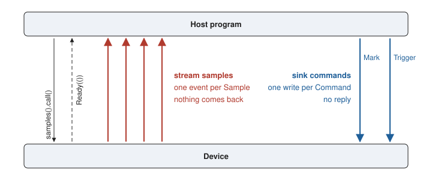

# Streams and sinks

Observing sends the newest value of a property, and a value that changes twice between two updates loses its
middle. A thermometer that logs temperatures needs every reading instead. A [[stream]] carries every value the device
sends, in order, from the device to the host. A [[sink]] carries values the other way, from the host into the
device. This chapter streams the thermometer's samples and sends it commands, from Rust and from Python.

Start the simulated device in a terminal of its own, and leave it running while you read:

```sh
cargo run -p thermometer --example thermometer_sim
```

## Declaring a stream and a sink

The thermometer's root trait, shown in [Properties](properties.md#declaring-a-property), has one stream and one sink:
`stream!(samples: Sample)` and `sink!(commands: Command)`. The names are from the device's point of view: a stream
goes out of the device, a sink goes into it. The item type is any type the wire format supports. `Sample` is the
struct from [Temperatures and timestamps](temperatures.md#a-sample-a-temperature-an-input-and-a-number), and
`Command` is an enum:

```rust
--8<-- "examples/thermometer_api/src/lib.rs:command"
```

`Trigger` takes one sample while the sampler is in `Triggered` mode. `Mark` restarts the samples' numbering at the
sequence number it carries.

The figure shows what travels between the host and the device. A host opens the stream with a call, and the device
answers it. After that, each sample goes up as an event of its own, and nothing comes back for it. Each command goes
down as a write of its own, also without a reply.



Each value arrives as the one value it was sent as, in the order it was sent. A stream or sink of this plain kind
promises nothing more: a value lost on the way is gone, and nobody is told. Kinds of streams that count or resend
their values are in [Streams in depth](../api/streams.md).

## Sending from the device

The device sends a sample with `samples_send`, which `ww_codegen!` generates for the stream. It takes the value and
the place to send it to. The thermometer sends from its event loop whenever a sample is due, and counts the samples
that could not go out:

```rust
--8<-- "examples/thermometer_device/src/lib.rs:send"
```

`up` is false while no host is connected. Sending then would be pointless, so the thermometer only counts the sample.

The device also gets a [[handler]] when a host opens the stream and one when it closes it. The thermometer needs
neither, so both do nothing:

```rust
--8<-- "examples/thermometer_device/src/lib.rs:samples"
```

A device whose samples cost power would start its sampler in `samples` and stop it in `close_samples`.

## Receiving on the device

Each write to the sink calls the handler `write_commands` with the value. It returns nothing, because a sink has no
reply:

```rust
--8<-- "examples/thermometer_device/src/lib.rs:commands"
```

A `Trigger` outside `Triggered` mode, or while a conversion still runs, has nothing to do. The device can't refuse
it, because there is no reply to refuse it with, so it counts it instead. `Command::Unknown(_)` is a variant that a
newer host knows and this firmware doesn't.

## Streaming from Rust

The generated [[client]] has `samples()` for the stream. `.call()` opens it and returns a handle, whose `recv()`
waits for the next sample. The program [`examples/thermometer/examples/stream.rs`] opens the stream, starts the
sampler at 5 Hz and receives two rounds of samples:

```rust
--8<-- "examples/thermometer/examples/stream.rs:stream"
```

Open the stream before you start the sampler. The host receives only the samples sent after the open, and doesn't
keep earlier ones.

For the sink, `commands()` returns a handle whose `send()` writes one command. The program puts the sampler into
`Triggered` mode, and triggers two samples, the second after restarting the numbering:

```rust
--8<-- "examples/thermometer/examples/stream.rs:sink"
```

Run it in a second terminal, while the simulated device runs in the first:

```sh
cargo run -p thermometer --example thermometer_stream
```

It prints one line per sample, with the seconds since the program started:

```text
--8<-- "docs/generated/thermometer/stream.txt"
```

Each round of continuous samples reads the four inputs at once, and the rounds are 200 ms apart. A triggered sample
arrives 100 ms after its trigger, the time the simulated board takes for one conversion. The commands arrive in the
order they were sent, so the `Mark` takes effect before the second `Trigger`.

## Flow control

A stream or sink of this plain kind doesn't slow down the side that sends. The device sends samples as fast as it
takes them. The host keeps up to 4 MiB of a stream's items that the program hasn't read yet, and drops what comes
after that. The host's writes to a sink go through a queue of limited size in the client, so a program can't send
faster than its link carries. Nothing tells the host, however, whether the device keeps up with them.

For most sensors this is the right choice: the newest data matters most, and nothing waits for a value that was
lost. When every value must arrive, choose another kind of stream or sink in the API. [Streams in
depth](../api/streams.md#flow-control) compares them.

## From Python

The Python module opens a stream with a `with` block, and iterating over the stream gives its values. A sink works
the same way, with `send()` for each value:

```python
--8<-- "examples/thermometer_py/streams.py:stream"
```

A `Sample` comes as a dictionary of its fields. The sink takes an enum variant as its name, or as a dictionary for a
variant with fields:

```python
--8<-- "examples/thermometer_py/streams.py:sink"
```

The whole script is [`examples/thermometer_py/streams.py`]. With the simulated device running, it prints:

```text
--8<-- "docs/generated/thermometer/streams_py.txt"
```

## Where to go next

- [Channels](channels.md) serves the thermometer's four inputs as an array, each with a property and a method of its
  own.
- [Streams in depth](../api/streams.md) covers streams with arguments, streams that count or resend their values,
  sinks with flow control, and arrays of streams.
