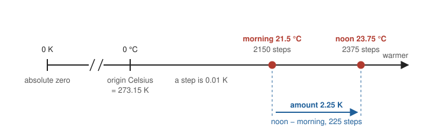

# Temperatures and timestamps

A temperature of 21.5 °C is not an amount like a rate of 250 Hz. It is a reading on a scale that starts somewhere,
and adding two such readings means nothing. This chapter shows how the thermometer types its temperatures, how it
numbers its samples, and how a host works out when each sample was taken. The compiler checks every sum on these
types.

The chapter continues the program [`examples/thermometer/examples/units.rs`] from
[Numbers that know their unit](units.md), which needs no device.

## A temperature is a point

The thermometer's API crate names the type of a temperature `Temperature`:

```rust
--8<-- "examples/thermometer_api/src/lib.rs:temperature"
```

`Point<Celsius, Fixed<Kelvin, Centi, i16>>` is a [[point]]: a position on a scale. Its second parameter is a `Fixed`,
the number from the previous chapter, here an `i16` that counts steps of 0.01 K. Its first parameter is the [[origin]]
of the scale, the place where the count is zero. The origin `Celsius` lies at 273.15 K, so a count of 2150 is
21.50 °C. A degree Celsius is one kelvin wide, which is why the steps are in kelvin.

On the wire a point is exactly its `Fixed`, and a `Fixed` is exactly its integer. A temperature is two bytes, and the
origin exists only in the type.

The difference between a point and an amount shows on a scale. Two temperatures are two points. The distance
between them is an amount in kelvin, which can be added to a point to move it.



## Points and amounts

The program's third part computes with two temperatures, a morning's and a noon's:

```rust
--8<-- "examples/thermometer/examples/units.rs:temperature"
```

The operators follow the figure:

- A point minus a point is an amount. `noon - morning` is 225 steps of 0.01 K, printed as `225 cK`.
- A point plus or minus an amount is a point. `noon - Fixed::new(300)` is 3 K cooler: 20.75 °C.
- A point plus a point doesn't compile. There is no meaning in 21.5 °C + 23.75 °C, so the type has no `+` for it.

`noon.to::<AbsoluteZero, Centi, u16>()` puts the same temperature on another scale, here kelvin from absolute zero.
The conversion is exact or nothing. It returns `None` when the result is not a whole number of the new steps:
296.9 K is no whole number of kelvin, so `to::<AbsoluteZero, One, u16>()` fails.

## A sample: a temperature, an input and a number

The thermometer sends its temperatures as samples. A `Sample` holds the temperature and two other numbers:

```rust
--8<-- "examples/thermometer_api/src/lib.rs:sample"
```

`input` is the input the sample was taken on. Its type is `IndexFrom1<Item, u8, Range<1, 4>>`: a position that
counts from 1, as the inputs are printed on the board. An index of its own type can't be mixed up with a count or
with an index that counts from 0.

`seq` is the sample's [[sequence number]]. It counts up by one per sample. A `u16` runs out after 65 535, so the
number wraps to 0 and goes on:

```rust
--8<-- "examples/thermometer/examples/units.rs:seq"
```

A plain `<` would say that 0 comes before 65 535. `Seq` has no `<` for that reason. `is_after` compares two sequence
numbers across the wrap, and `distance` counts the samples between them. Both work while the two numbers are less
than half the range apart: here, 32 768 samples.

## When a sample was taken

A sample of the thermometer carries no time. It doesn't need one: in `Continuous` mode the device samples at a fixed
rate, so the sequence number tells when a sample was taken. Sample 12 at 5 Hz was taken 12 periods of 200 ms after
sample 0, that is 2.4 s later.

The program's last part does this sum. Its function `stamp` returns the temperature together with the time:

```rust
--8<-- "examples/thermometer/examples/units.rs:stamp"
```

`UnixMicros<u64>` is a point too. Its origin is the Unix epoch, 1 January 1970 UTC, and it counts microseconds in a
`u64`. Adding the amount `since_start`, a `Micros<u64>`, moves it to the sample's time. [[Timed]] is the value
with that time: `Timed::new(t, value)` holds both, and `reading.t` and `reading.value` read them back.

```rust
--8<-- "examples/thermometer/examples/units.rs:timed"
```

Run the program, `cargo run -p thermometer --example thermometer_units`. After the lines of the previous chapter, it
prints:

```text
--8<-- "docs/generated/thermometer/points.txt"
```

A device that samples at irregular times sends the time with each value. Its API then uses `Timed` itself, such as
`stream!(current: Timed<Ampere>)`. Such a time is a point of the device's own clock: `DeviceMicros<u32>`, the
microseconds since the device started, in a `u32` that wraps every 71.6 minutes. The host's client unwraps it into
the full time. [`ww_si`'s page](../std_library/ww_si.md#timed-values) covers the clocks and their wrapping.

## From Python

Python reads a temperature as a `ww.Quantity`, the same type it uses for a `Fixed`. A point knows its origin as well
as its unit:

```python
--8<-- "examples/thermometer_py/units.py:temperature"
```

`float(temp)` reads the temperature in degrees Celsius, the scale of its origin. `temp.to_si()` reads it in kelvin,
the unit of its steps. The script's last two lines, in the output of the [previous chapter](units.md#from-python),
show both.

## Where to go next

- [Properties](properties.md) declares values a host reads and writes, such as the thermometer's gain.
- [Points and origins on the wire](../std_library/points.md) covers origins of your own, such as a board's
  temperature register that reads 0 at 25 °C.
