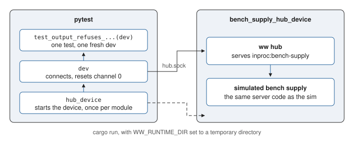

# A test bench in Python

An instrument is tested the way it is used: set it up, switch it on, measure, and check the answer. A test bench
does that for every case, every time the firmware changes. This chapter builds such a bench for the bench supply with
pytest, the usual Python test runner, against the simulated device. No board is needed, so the bench runs on any PC
and in continuous integration.

The bench is [`examples/bench_supply_py/tests/test_bench_supply.py`]. The `wire_weaver` Python module of
[From Python](python.md) drives the device, and learns its API from the device itself. The tests therefore need no
code generated for the bench supply.

## How the bench is built

The tests run in one process and the device in another. A fixture starts the device once for all tests of the file.
Each test then connects to it, sets up what it needs, and checks the answers.



The device process is `bench_supply_hub_device`, in [`examples/bench_supply/src/bin/hub_device.rs`]. It holds the
simulated bench supply and the [[hub]] together. The hub is the program that shares devices between the programs of
one user: every client connects to it through a socket, and it passes the calls on to the device. Several tests, a
script and a GUI can then talk to one device at the same time.

## Starting the device

A pytest [fixture](https://docs.pytest.org/en/stable/how-to/fixtures.html) is a function that sets something up for
the tests that name it. `hub_device` builds and starts the device process, waits until the hub's socket appears, and
stops the process after the last test:

```python
--8<-- "examples/bench_supply_py/tests/test_bench_supply.py:hub_device"
```

`scope="module"` starts the device once for the whole file, not once per test. `WW_RUNTIME_DIR` points the hub at a
fresh temporary directory, so the bench never meets a hub or a device of another program on the same PC.

## A fresh device for each test

The fixture `dev` connects to the device through the hub, and closes the connection when the test ends. The device
key `inproc:bench-supply` names the simulated device inside the hub's process:

```python
--8<-- "examples/bench_supply_py/tests/test_bench_supply.py:dev"
```

All tests share one device process, so a test could find the output on where the previous test left it. `dev`
therefore switches the output off and sets both limits to 0 before it hands the device over. Every test starts from
the same state, whatever ran before it.

## Writing the tests

A test is a function whose name starts with `test_`, and it names `dev` as its argument. The first test checks the
refusal of [Errors](errors.md): with no voltage set, the output stays off.

```python
--8<-- "examples/bench_supply_py/tests/test_bench_supply.py:no_voltage"
```

`pytest.raises` checks that the call raises `ww.RemoteError`, and `excinfo.value` is the exception. Its `value` is
the variant of `OutputError` the device answered with. The last line reads `output_on` to check that the refusal
left the output off.

A test of normal operation sets the limits, switches the output on, and checks what the channel measures. 5 V on
the first channel's 10 Ω load is 500 mA:

```python
--8<-- "examples/bench_supply_py/tests/test_bench_supply.py:measures"
```

A measurement is a dictionary of its fields, and each field is a quantity whose `value` is its integer: millivolts
and milliamperes, as `Fixed<Volt, Milli, u16, ..>` says. The test compares those integers, so no rounding of a
float can make it flaky.

A common error is checked through `common`, as in [Errors](errors.md#from-python). The limits refuse a change while
the output is on, and the old limit stays:

```python
--8<-- "examples/bench_supply_py/tests/test_bench_supply.py:wrong_state"
```

## Running the bench

The Python module and pytest come from the project in [`examples/bench_supply_py/pyproject.toml`], managed with
[uv](https://docs.astral.sh/uv/). uv builds the module from the repository's Rust sources the first time, and
again only when they change. Run the bench from the repository's root:

```sh
just test-bench-supply-py
```

The recipe runs `uv run --group dev pytest -q tests` in `examples/bench_supply_py`. The first run also builds the
device process, which takes a minute. pytest's short summary (`-rA`) names each test of the bench with its outcome:

```console
--8<-- "docs/generated/bench_supply/pytest.txt"
```

The last line of a real run also gives the time the run took. A failing test prints the line of its `assert`, the
values on both sides, and the device's answer.

## Against a board

The tests only use `dev`, so the same tests check a board when `dev` connects to one. A board needs no hub process
of the bench's own: `ww.connect` with a USB filter, such as a serial number, reaches it as in
[From Python](python.md#connecting), and `hub_device` is then left out. The bench supply has no firmware, so its
bench always runs against the simulated device.

## Where to go next

- [Settings that survive a reboot](settings.md) keeps a device's settings in flash.
- [Python](../python.md) covers the module in full: every type's Python value, streams and the interactive console.
