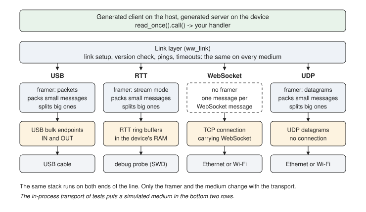

# Choosing a transport

A [[transport]] carries a device's messages between the device and a host program. The API trait, the handlers and
the generated client don't know which one is in use. You choose it in the client's configuration, and the same call
then works over a USB cable, a network or a debug probe.

This chapter shows what a transport changes, helps you pick one, and runs the thermometer over two of them. The
chapters after it cover each transport on its own.

## What a transport changes

A call from your program passes through four layers on its way to the device, and through the same four on the way
back. The figure shows them for each transport.



- The generated client and server turn a call into a message and a message into a call. They are the same for every
  transport.
- The [[link layer]] opens a session with the device and checks that both sides speak the same version. It pings the
  other side to notice when it is gone. It is the same for every transport too.
- The [[framer]] packs several small messages into one packet and splits a big message over several packets. USB, RTT
  and UDP use it. WebSocket doesn't, because a WebSocket message already has a length of its own.
- The [[medium]] moves the bytes. It is the part that differs. It can be the bulk endpoints of a USB device, ring
  buffers that a debug probe reads, a TCP connection, or UDP datagrams.

Because the top two layers are shared, everything above the medium behaves the same: link setup, introspection,
timeouts, streams and observers. A choice of transport is a choice of cable and of what happens when a packet is
lost, not a choice of API.

## Which one to pick

Pick by what connects the device and the host.

| Transport | Pick it when | The device needs | Chapter |
|---|---|---|---|
| USB | The board has a USB port, or you want the fastest and simplest link. | A USB peripheral and `wire_weaver_usb_embassy`. | [USB](usb.md) |
| WebSocket | The device is on a network that can run TCP: a Linux board, a gateway, a simulator on your PC. | A TCP stack, or a PC. | [WebSocket](websocket.md) |
| UDP | The device is on a network, and a lost stream event matters less than a stall. | A UDP socket. | [UDP](udp.md) |
| RTT | A debug probe is attached and the board has no USB to spare. | The probe and an RTT control block in RAM. | [RTT](rtt.md) |
| Byte stream | A server on a PC serves the API over TCP, over `ssh` or over a stream of your own. | A host server, not a device. | [Serial lines and other byte streams](byte_streams.md) |

When more than one fits, USB is the default. It needs no driver on Windows, macOS or Linux. It tells many devices apart
by their serial numbers, and it notices when a device is unplugged. RTT is the choice for early bring-up, when
the USB code isn't written yet. A program only tries the transports whose host features are enabled, so
the features of `wire_weaver_client` also limit what it can reach.

Tests use a sixth transport, *in-process*: the simulated device runs in the same process as the host, over channels
instead of a cable. It is how the book's tests run the thermometer without hardware.

## The same call over two transports

The thermometer example has a simulated device that serves its API over WebSocket or over UDP. Its host program
connects over the transport you name. The host program is
[`examples/thermometer/examples/connect.rs`]. Start the simulated device in a terminal of its own, once for each
transport:

```sh
cargo run -p thermometer --example thermometer_sim            # WebSocket on port 8080
cargo run -p thermometer --example thermometer_sim -- --udp 9000
```

The program connects with a config closure. For WebSocket the closure names the URL:

```rust
--8<-- "examples/thermometer/examples/connect.rs:websocket"
```

For UDP it names an address and a port instead:

```rust
--8<-- "examples/thermometer/examples/connect.rs:udp"
```

`no_ww_usb()` tells the client not to look for USB devices as well. Everything after `connect()` is identical: the
program reads one sample and prints it. Run it once for each transport:

```text
--8<-- "docs/generated/thermometer/connect_websocket.txt"
--8<-- "docs/generated/thermometer/connect_udp.txt"
```

Both runs print the same sample. The test `book_output_connect` in
[`examples/thermometer/tests/it/connected.rs`] produces this text from a new simulated device for each medium, on a
clock that the test controls. On your PC the temperature drifts with the time since the simulator started.

## Where to go next

- [USB](usb.md), [WebSocket](websocket.md), [UDP](udp.md) and [RTT](rtt.md) each connect the same device over that
  medium and say what to watch for.
- [When the device goes away](connection_loss.md) keeps a host connected through a reset or an unplugged cable.
- [Connecting in depth](../transport/overview.md) lists every connect step that can be timed, and the transports
  that are planned.
