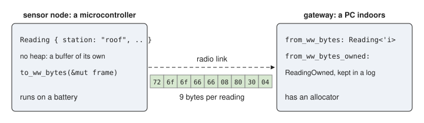

# Your types on the wire

A program that sends a value over a radio link, a serial line or USB turns it into bytes, and the program at the
other end turns the bytes back into a value. The rules for those bytes are a [[wire format]]. WireWeaver's wire
format is [[ShrinkWrap]]: it packs values down to single bits, it works on a microcontroller without an allocator,
and old and new versions of a type read each other's bytes. This chapter puts one struct on the wire with ShrinkWrap
alone, without an API or any other part of WireWeaver.

The chapters of "Your data on the wire" use the sensor packet example. A weather station has a sensor node on its
roof: a microcontroller that measures the temperature and the humidity, and sends each reading over a radio link to a
gateway, a PC indoors. The node runs on a battery, and every byte it sends costs airtime and charge.



The example runs both ends in one program on your PC:

```sh
cargo run -p sensor_packet --example sensor_packet_radio
```

## Adding ShrinkWrap to a crate

ShrinkWrap is the crate `shrink_wrap`. The example also uses `ww_si`, which gives numbers a unit, as the temperature
below shows. Here are the dependencies of [`examples/sensor_packet/Cargo.toml`]:

```toml
--8<-- "examples/sensor_packet/Cargo.toml:deps"
```

`workspace = true` takes each dependency from the repository's workspace. In a crate of your own, name the
repositories instead: `shrink_wrap = { git = "https://github.com/romixlab/shrink_wrap" }` and
`ww_si = { git = "https://github.com/vhrdtech/ww_base" }`. Both crates are `no_std`, so the same dependencies serve
the node's firmware and the gateway's program.

## Declaring a type

The `#[derive_shrink_wrap]` attribute on a struct generates the code that writes it to bytes and reads it back. Here
is the reading the node sends, from [`examples/sensor_packet/src/lib.rs`]:

```rust
--8<-- "examples/sensor_packet/src/lib.rs:reading"
```

The attribute takes a list of directives. `derive(Debug, PartialEq)` adds the usual derives, and
`owned(feature = "std")` adds a second type for programs with an allocator. The next chapter,
[Borrowed and owned](borrowed_and_owned.md), explains both.

Every field is a type ShrinkWrap knows. `station` is a string borrowed from the bytes it was read from, which is what
the lifetime `'i` is for. `humidity` is an `Option`, because the humidity sensor sometimes doesn't answer.
`battery_low` is a `bool`. The temperature and the humidity are numbers that carry their unit in their type:

```rust
--8<-- "examples/sensor_packet/src/lib.rs:units"
```

A `Temperature` is an `i16` on the wire that counts hundredths of a degree Celsius, and a `Humidity` is a `u8` from 0
to 100 percent. The type costs nothing on the wire: the bytes are those of the plain number. The chapter
[Numbers that know their unit](../std_library/ww_si.md) explains how such types are built.

## Writing a value

The node writes a reading into a buffer it owns and hands the bytes to its radio. `to_ww_bytes` does the writing:

```rust
--8<-- "examples/sensor_packet/src/lib.rs:send"
```

`to_ww_bytes` returns the part of `frame` that holds the value. It allocates nothing, so it runs on a
microcontroller without a heap. When the buffer is too small, it returns an error instead of writing past the end.
The example sends 21.5 °C and 48 % from the roof, with the battery fine, and prints the bytes:

```text
--8<-- "docs/generated/sensor_packet/radio.txt:1:2"
```

## Where each bit goes

Nine bytes hold the whole reading. The layout below shows every bit of them, coloured by what it holds:

```bits
--8<-- "docs/generated/sensor_packet/reading_bits.txt"
```

Three rules explain the layout:

1. **A flag takes one bit.** `battery_low` is one bit, and so is the flag that says whether `humidity` is `Some`.
2. **Bytes start on a byte.** A value of whole bytes, such as the `u8` of the humidity, starts on a fresh byte. The
   bits skipped before it are [[padding]], and they are always zero.
3. **Lengths go to the back.** The string's length, 4, is not in front of `"roof"` but in the last nibble of the
   message. A nibble is four bits, and it holds a length up to 7.

Most formats write a length in front of its value, so they must know the size of a value before they write it.
ShrinkWrap writes the value first and its length at the back of the buffer, so it writes in one pass and never moves
bytes. A small length costs half a byte. The reader walks the values from the front and takes the lengths from the
back.

There are no field names and no type tags in the bytes. The reader knows the type, so the bytes hold only the values.

## Reading it back

The gateway reads the bytes with `from_ww_bytes`:

```rust
--8<-- "examples/sensor_packet/src/radio.rs:receive"
```

The reading it gets back is the one the node sent:

```text
--8<-- "docs/generated/sensor_packet/radio.txt:3:3"
```

Reading copies nothing. The `station` of the result points into `frame`, which is why the result borrows it, and
why `Reading` has a lifetime. [Borrowed and owned](borrowed_and_owned.md) shows how to keep a reading after the
buffer is gone.

## Bytes that are not a reading

A radio link loses bytes and flips bits. ShrinkWrap reads bytes from anywhere without trusting them: a buffer that
can't hold a value of the type is an error, never a panic or a read past the end. The example damages its frame in
two ways and reads each:

```text
--8<-- "docs/generated/sensor_packet/radio.txt:4:5"
```

The first frame has 120 (`78`) where the humidity was. `Humidity` only holds 0 to 100, so the read fails with
`SubtypeOutOfRange` before any code sees the value. The second frame lost its last byte, and it still reads, as
nonsense: the station is empty and the temperature is 285.3 °C. The missing byte held the string's length, so the
reader took the byte before it, and those bits happened to make a valid reading.

ShrinkWrap has no checksum, so it can't tell a damaged message from a different one. Media such as USB and CAN check
every frame themselves. On a link without such a check, such as a serial line, WireWeaver's [[framer]] adds a
checksum to each message. With ShrinkWrap alone, put a checksum around your messages, or use a radio whose frames
have one.

## Where to go next

- [Borrowed and owned](borrowed_and_owned.md) keeps a reading on the gateway after the frame's buffer takes the next
  one.
- [Built-in types](built_in_types.md) lists every type that can be a field, with its bytes.
