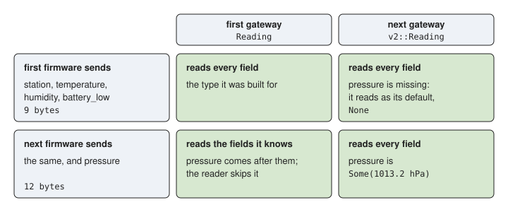

# Types that change

Firmware changes after it ships. The next sensor node of the example gets a pressure sensor, and its readings carry
the air pressure. Nodes on old roofs keep the first firmware for years, and a gateway may be older or newer than the
nodes it hears. This chapter adds a field and an enum variant so that every old and new end keeps reading the
others' bytes.

## Adding a field

A new field goes after all the others and gets a default with `#[default = ..]`. Here is the reading of the next
firmware, from [`examples/sensor_packet/src/v2.rs`]:

```rust
--8<-- "examples/sensor_packet/src/v2.rs:reading"
```

The example keeps both versions side by side, the first one as `Reading` and the next one as `v2::Reading`, so that a
test can check them against each other. In a real project there is one `Reading`, and the next firmware's source
replaces the first.

The default is what a reader of the next version gets from bytes the first version wrote. Those bytes end before the
new field, so the reader takes the default instead. Here, a reading from the first firmware has no pressure.

## Old and new ends together

Four pairs of a writer and a reader can meet. The figure shows what each reader gets:



The test `book_output_versions` in [`examples/sensor_packet/tests/it/book.rs`] writes the bytes of both firmwares and
reads each with the other version:

```text
--8<-- "docs/generated/sensor_packet/versions.txt:1:6"
```

The next firmware sends 12 bytes, three more than the first. The pressure's flag shares a byte with `battery_low`,
`40`, and its `u16`, `94 27`, takes two bytes. The station's length, which shared the byte of `battery_low` in the
first firmware, gets a last byte of its own, `04`.

- The next gateway reads the first firmware's nine bytes, and `pressure` is `None`, its default.
- The first gateway reads the next firmware's twelve bytes. It reads the four fields it knows and stops before the
  pressure.

## Padding becomes a field

The first firmware's last byte, `04`, holds `battery_low`, three bits of padding and the station's length. The next
version reads the pressure's flag from the bit right after `battery_low`, which in the first firmware's bytes is
padding. Padding is always zero, so the flag reads as 0, which means `None`.

This works because the default is `None`, the value that a zero bit means. A new field that takes one bit, such as a
`bool` or the flag of an `Option`, may land in such padding, so give it the default its zero bits mean: `false` for a
`bool`, `None` for an `Option`.

## A new variant

The next firmware also sends a message when its rain sensor gets wet. The new variant goes after the others, so the
variants that exist keep their numbers:

```rust
--8<-- "examples/sensor_packet/src/v2.rs:message"
```

A first gateway reads `Message::Rain` as the variant the derive adds to every enum,
[`Unknown`](structs_and_enums.md#a-variant-the-reader-doesnt-know), with the new variant's number:

```text
--8<-- "docs/generated/sensor_packet/versions.txt:7:9"
```

`Rain` has no fields. A new variant may carry fields too: the reader finds the end of an enum it doesn't know from
the enum's length, which it records like a struct does.

## What breaks old readers

A reader finds each field by its place in the bytes, not by its name. A change that moves a field or changes what
its bits mean therefore breaks every reader of the other version:

- removing a field, or adding one anywhere but at the end;
- changing a field's type, such as a `u8` into a `u16`;
- reordering the variants of an enum, or adding one anywhere but at the end.

Renaming a field or a variant leaves the bytes as they are, because names never go on the wire. The
[evolution rules](../evolution/rules.md) list every change and what it does to old and new readers, and the
[evolution checker](../evolution/checker_tool.md) compares two versions of a type for you.

## Where to go next

- [A device on your PC](../api/overview.md) puts these types into an API: methods, properties and streams of a
  device.
- [Size assumptions](../serdes/size_assumptions.md) shows how a type that will never change can drop its length and
  save a nibble or two.
