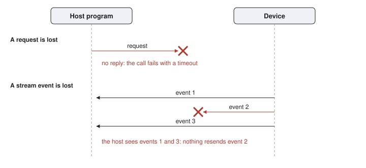

# UDP

UDP sends each message as a [[datagram]]: a packet that is sent without a connection and without a promise that it
arrives. It has less overhead than a TCP connection, and a stalled network never delays the datagrams behind it. This
suits a device that sends many readings, where a missing one matters less than a late one.

This chapter serves the thermometer over UDP from your PC, connects to it, and explains what a lost datagram costs.

## Serving the thermometer over UDP

The simulated thermometer serves UDP on the loopback address when you pass `--udp` with a port. Start it in a terminal
of its own:

```sh
cargo run -p thermometer --example thermometer_sim -- --udp 9000
```

It prints `thermometer at udp://127.0.0.1:9000`. The serving code is `simulated_udp()` in
[`examples/thermometer/src/lib.rs`]:

```rust
--8<-- "examples/thermometer/src/lib.rs:simulated_udp"
```

The function takes any `DatagramSocket`, a socket that receives from anyone and sends to an address. The device runs
the same event loop as over every other medium, with `udp_server()` in place of `ws_server()`. A
`UdpConnection` is the table of hosts that talk to the socket; this one holds one host. On a board, an
`EmbassyNetUdpSocket` on an `embassy-net` stack is the socket, as the [UDP in depth](../transport/udp.md) page shows.

## Connecting

The host selects the device by its address:

```rust
--8<-- "examples/thermometer/examples/connect.rs:udp"
```

A host name works too, and is resolved when connecting. So does an IPv6 address such as `[fe80::1%2]:9000`. Run the
program in a second terminal with `cargo run -p thermometer --example thermometer_connect -- udp`. It prints the
sample of the earlier chapter:

```text
--8<-- "docs/generated/thermometer/connect_udp.txt"
```

[Choosing a transport](transports.md) runs the same program over WebSocket and gets the same line.

Everything above the medium is the same as over USB or WebSocket: link setup, the version check, introspection, pings
and timeouts. Two things differ.

- UDP has no way to list devices, so the host has to know the address. A config can't filter by serial number or label
  before connecting.
- The host's socket is connected to the device address. The operating system therefore drops datagrams from anyone
  else, and reports at once when nothing listens on the port.

## What a lost datagram costs

A network drops datagrams now and then, and UDP doesn't resend them. What a drop costs depends on what it carried.



- A lost request or reply makes the call fail with a timeout. The program decides whether to call again.
- A lost event of a stream is gone. The host sees the events before and after it, and nothing resends the missing one.

If a lost event is not acceptable, use a transport that resends, such as [WebSocket](websocket.md). A
[counted stream](../api/counted_streams.md) is the other choice: it tells the host what it missed.

## Where to go next

[UDP in depth](../transport/udp.md) lets several hosts share one device port, and shows how the tests drop datagrams on
purpose.
