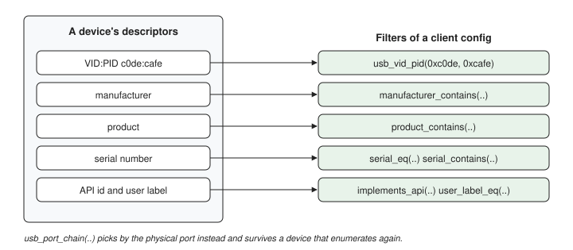

# USB

USB is the transport to start with when a board has a USB port. A WireWeaver device uses a vendor-specific interface
with plain bulk endpoints, so Windows, macOS and Linux need no driver for it. The host side is the pure-Rust
[nusb](https://github.com/kevinmehall/nusb) library, so there is no libusb to install either.

This chapter connects a host program to a thermometer on a board. It also shows the firmware that makes the board
reachable. The thermometer's firmware runs on two boards, the Pico 2 and the Nucleo G0B1RE. It uses the handlers and the event
loop of the simulated device from the earlier chapters, so only the board code differs.

## Finding a device

A USB device describes itself in [[string descriptors]], short texts that the operating system reads when the device is
plugged in. WireWeaver puts the API into one of them, so a host knows what a device does without opening it. Each
filter of a client config looks at one descriptor, as the figure shows.



The filters combine: a device must pass all the filters of different kinds, and any one of several filters of the
same kind. With no filter at all, `usb()` accepts any WireWeaver device. The thermometer's host program connects to
the first one, or to the one whose serial number it is given:

```rust
--8<-- "examples/thermometer/examples/connect.rs:usb"
```

[`examples/thermometer/examples/connect.rs`] is the whole program. With a board plugged in, run it with
`cargo run -p thermometer --example thermometer_connect -- usb`, and add `--serial` when several boards are plugged
in. It prints the same line as the other transports, `input 1:` and the chip's temperature.

## Listing the devices

The `ww` command line tool lists every WireWeaver device on USB with `ww list`. Each line has the columns of the
table; the API column is the API id that the device put into its descriptor.

| Column | What it shows |
|---|---|
| `LOCATION` | The USB bus and port, and the VID and PID. |
| `PRODUCT` | The product string, for example `Nucleo G0B1RE thermometer`. |
| `SERIAL` | The serial number, unique to the chip. |
| `API` | The API crate and its version, for example `thermometer_api@1.0.0`. |
| `HASH` | The first 8 bytes of the hash of the API, the same value that link setup compares. |
| `LABEL` | A label that the device owner can store on the device. |

`ww list --api thermometer_api@^1.0` keeps the devices that serve a compatible thermometer, and `--serial` and
`--product` match a part of a text. The [command line tool](../cli.md) chapter has the other options.

## Serving over USB

On the device, `wire_weaver_usb_embassy` puts the generated server on top of any
[embassy-usb](https://docs.rs/embassy-usb) driver. `usb_init()` returns two things that each run in a task of their
own. The USB device talks to the host controller, and the server runs your handlers. The Nucleo's
firmware, [`examples_mcu/nucleo_g0b1re/src/bin/thermometer.rs`], starts both:

```rust
--8<-- "examples_mcu/nucleo_g0b1re/src/bin/thermometer.rs:usb"
```

The arguments of `usb_init()` in order:

1. `driver` is the chip's USB driver. It is the only part that is specific to the chip.
2. The buffers are static memory that `usb_init()` takes; their sizes come from the longest USB packet and the longest
   message the device accepts.
3. `UsbTimings` sets how long the device collects small messages into one packet. The `fs_higher_speed()` value is
   1 ms for a full-speed bus.
4. `Thermometer::link_config()` is what the link layer tells the host during setup: the API's identity and version.
5. `Thermometer::API_ID` is the text of the interface descriptor that `ww list` shows in its API column.
6. The closure fills in the descriptors that you choose, here the product name and the chip's unique id as the serial
   number.

The Pico 2 does the same in [`examples_mcu/rp2/src/bin/thermometer.rs`], with its own driver. To flash a board, run
`just run nucleo thermometer` in `examples_mcu/nucleo_g0b1re`, or `just run rp2 thermometer` in `examples_mcu/rp2`.
Then run the host program above.

## What you get

- **Hot-plug.** A device that disappears fails the calls in flight, and the program can connect again without
  restarting. [When the device goes away](connection_loss.md) shows how to do that automatically.
- **Many messages per packet.** Small requests and events share one USB packet, so throughput is limited by the bus
  and not by the packet rate.
- **Full duplex.** Sending and receiving never block each other, so a busy device can't stall the host.
- **An identity check.** Link setup compares the API and its version before any application data flows. A host
  never talks to a device with another API by mistake.

## Limits

- The endpoints (`0x01` out, `0x81` in) and interface `0` are fixed.
- Isochronous endpoints aren't supported, and aren't needed.
- On Linux, listing devices needs no setup, but opening one needs access to `/dev/bus/usb/`. A `udev` rule that gives
  your user that access is the usual fix when connecting fails with a permission error.

## Where to go next

[USB in depth](../transport/usb.md) covers a driver that `usb_init()` doesn't know, your own VID and PID, and the
accumulation window. [How USB works inside](../transport/usb_internals.md) lists the descriptors and the framing, for
anyone who writes a device without `wire_weaver_usb_embassy`.
