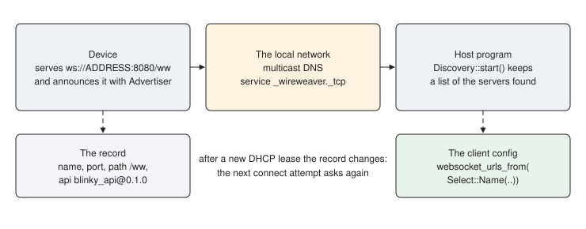

# WebSocket

WebSocket carries a device's messages over a TCP connection, so any device on a network that runs TCP can be a
WireWeaver device. Examples are a Linux board, a gateway in front of devices on other media, and a simulator on your
PC. TCP resends
what the network loses, so no message goes missing while the connection holds. This is the transport of the simulated
thermometer in the earlier chapters.

This chapter serves the thermometer over WebSocket and connects to it from Rust, the command line and Python. It then
shows how a device announces itself on the local network, so that hosts find it without a typed address.

## Serving over WebSocket

The simulated thermometer serves WebSocket on port 8080 of the loopback address. The `thermometer_sim` example
listens on a TCP port and hands each client's stream to the device:

```sh
cargo run -p thermometer --example thermometer_sim
```

The device side is the function `simulated()` in [`examples/thermometer/src/lib.rs`]:

```rust
--8<-- "examples/thermometer/src/lib.rs:simulated"
```

`IoSocket` takes a stream of clients, here the connections that a TCP listener accepts. `WsConnection` accepts one
client at a time, and `ws_server()` builds the server that the thermometer's event loop runs, exactly as it does over
USB. On a board, an `EmbassyNetSocket` on an `embassy-net` TCP stack takes the place of `IoSocket`.

## Connecting

A WebSocket device is selected by its URL:

```rust
--8<-- "examples/thermometer/examples/connect.rs:websocket"
```

Only plain `ws://` URLs work; there is no `wss://` yet. The examples serve the path `/ww`. The client doesn't check
a serial number or a label before connecting, because it knows nothing about the device until it connects. Link setup
still checks the API.

The `ww` tool takes the URL with `--websocket`, as the [Properties](properties.md) chapter shows:

```sh
ww --websocket ws://127.0.0.1:8080/ww introspect -d
```

The Python module takes it as `websocket_url`:

```python
--8<-- "examples/thermometer_py/properties.py:connect"
```

The same function reaches the other transports. `ww.connect()` without arguments looks for a USB device, and
`ww.connect(rtt="STM32G0B1RETx")` reaches a board through a debug probe.

When a device has more than one address, a LAN address and a VPN one for example, `websocket_urls([..])` takes all
of them. The client opens them at once, and the first that answers wins.

## Announcing a device on the network

Typing an address is fine for a simulator. A device on a home or office network gets a new address from the router
now and then. Such a device announces itself with DNS-SD over multicast DNS. The announcement is a short record that
every program on the same network segment can read.



The `ww_dns_sd` crate announces a record for any server. The example `blinky_ws_device`
([`examples/blinky/examples/ws_device.rs`]) serves the blinky API over WebSocket from a PC and announces it:

```rust
--8<-- "examples/blinky/examples/ws_device.rs:advertise"
```

The record has the instance name that people see, the port, and the path of the WebSocket. It also has the API's
identity and wire version. An id that the device keeps for good means that a rename doesn't make it a different
device. While the `Advertiser` lives, the record is on the network; dropping it withdraws the record. On Linux,
`avahi-browse -r -t _wireweaver._tcp` lists what is announced.

!!! warning "Everything announced reaches the whole network"

    Every program on the same network segment can read the record, and nothing proves who sent it. Announce only a
    server that may be found by everyone there, and never put a secret in the record.

## Finding a device on the network

The host side is `Discovery`. It browses for `_wireweaver._tcp` on a thread of its own and keeps the list of servers
current as they come, change address and go. The example [`examples/blinky/examples/discover.rs`] prints the list:

```rust
--8<-- "examples/blinky/examples/discover.rs:browse"
```

Printing a list is for people. A program connects through `websocket_urls_from()`, which takes a source of URLs that
is asked again at every connect. A device that gets a new address after a router restart is then found at its new
address by the next attempt:

```rust
--8<-- "examples/blinky/examples/discover.rs:follow"
```

`Select::Name` picks a server by the name people see. `Select::Id` picks by the stable id, which survives a rename,
and `Select::Api` picks by the API's crate. The list in the second argument of `urls()` holds addresses to try
after the discovered ones, such as a saved or VPN address. The `keep_trying` part is the subject of
[When the device goes away](connection_loss.md).

To try it, run the device on one PC and the host on another PC of the same network:

```sh
cargo run -p blinky --example blinky_ws_device -- --id blinky-demo   # the device
cargo run -p blinky --features dns_sd --example blinky_discover       # the host
```

## Where to go next

[WebSocket in depth](../transport/websocket.md) covers the wire format, the limits of the device side, and the two
responders that announce records.
