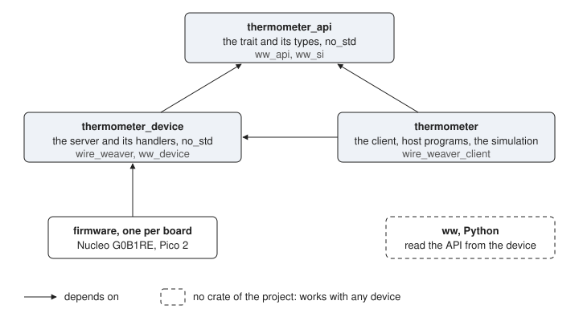

# Your own project

The examples in this book are small projects of their own, and your device can take the same shape. This chapter
shows that shape on the thermometer: which crates a project has, what each one depends on, and how the API crate is
named and versioned. It then starts a project from a template for your board and writes its handlers with
`ww api scaffold`.

## The crates of a project

An API is shared by the firmware and by every program that talks to the device. So it lives in an [[API crate]] of
its own, and the code on each side lives in crates that depend on it. The thermometer has three such crates and the
firmware of two boards:



| Crate | Holds | Builds for |
|---|---|---|
| `thermometer_api` | the [[API trait]] and its types | the firmware and the host, `no_std` |
| `thermometer_device` | the [[server]]: its state, its handlers and its event loop | the firmware and the simulated device, `no_std` |
| `thermometer` | the generated [[client]], host programs and the device simulated on a PC | the host |
| firmware, one per board | the board's pins and transport, around `thermometer_device` | the board's chip |

The firmware crates hold little code of their own: [`examples_mcu/nucleo_g0b1re/src/bin/thermometer.rs`] and
[`examples_mcu/rp2/src/bin/thermometer.rs`] give the same server a board and a USB transport. The simulated device in
[`examples/thermometer/src/lib.rs`] gives it a board that exists only in software. So the code you test on your PC
is the code that runs on the board.

`ww` and the Python module depend on no crate of the project. They read the API from the device itself, through
[[introspection]], so they work with any device without being built for it.

## What each crate depends on

The API crate depends on `ww_api` and nothing from the runtime. `ww_api` holds what an API needs to compile: the
macros, the wire format and the common error types. The thermometer also takes `ww_si` for its numbers with units:

```toml
--8<-- "examples/thermometer_api/Cargo.toml:dependencies"
```

The device crate adds `wire_weaver`, which generates the server code, and `ww_device`, which runs it over a
[[transport]]:

```toml
--8<-- "examples/thermometer_device/Cargo.toml:dependencies"
```

The host crate takes the API with its `std` feature and `wire_weaver_client` with the transports it uses. The
thermometer's host crate also depends on the device crate, for the simulated device:

```toml
--8<-- "examples/thermometer/Cargo.toml:dependencies"
```

## The API crate's name and versions

The name of the API crate identifies the API worldwide. It goes into the API's identity that a device reports when
a host connects, so two different APIs must not share a name. Publish the crate on crates.io for an open project,
or pick a name unique enough for internal use.

The crate carries two versions, as [Changing your API](changing_your_api.md) explains: the crate version for Rust
code and the [[wire version]] for devices and hosts. A new API starts on `w0.0`, the design line, where any change is
allowed and no [[snapshots]] are kept. Its first release moves to `w1.0`, as the thermometer's has. From then on,
the [[evolution checker]] watches every change.

## Starting from a template

A template is a repository with this shape, ready to copy and rename. Pick the one for your board:

| Template | Board and transport | What it has |
|---|---|---|
| [nucleo_g0b1re_template](https://github.com/romixlab/nucleo_g0b1re_template) | ST Nucleo-G0B1RE, RTT through the board's own ST-LINK | an API crate, firmware with the device's firmware info, log, settings and reboots, a Rust client, a command line and a Python module |
| [wire_weaver_template](https://github.com/vhrdtech/wire_weaver_template) | boards with USB, such as the ST Nucleo-H743ZI2 | an API crate, firmware, a Rust driver with examples and a Python wrapper |

The Nucleo-G0B1RE template needs nothing but the board and its USB cable. Starting from it takes these steps:

1. On GitHub, press "Use this template" and clone your new repository.
2. Run `just setup`. It installs the Rust target, probe-rs and the other tools, and prints the steps that need root
   for you to run.
3. Give the project your own name with `just rename my_board`. It renames the crates, the directories and the
   command line.
4. Run `just run` with the board plugged in. It builds and flashes the firmware and shows its log.
5. Change the API crate, and write the handlers of what you added, as the next section shows.

The template's own README describes each step and the commands it adds for the board.

## Handlers from the API

Each method and property of the API needs a [[handler]] in the device crate. Their names and signatures depend on the
options of the `ww_codegen!` call, so don't write them by hand. `ww api scaffold` reads the API crate and prints the
server struct, a stub for each handler and the `ww_codegen!` call that matches them. For blinky's API, with async
handlers as the book's devices use:

```sh
ww api scaffold examples/blinky_api --use-async
```

```rust
--8<-- "docs/generated/blinky/scaffold.txt"
```

Each stub returns `Unimplemented` until you write its body; a host that calls it gets a clean error meanwhile. The
`ww_codegen!` call at the end generates the server code. Its options must match the ones you gave `ww api scaffold`,
or the handlers won't compile. `ww api scaffold --help` lists every option.

When the API changes later, run `ww api scaffold` again with the same options and compare its stubs with your
handlers. New items need new handlers, and the compiler names any signature that changed.

## Where to go next

- [Python in full](python_in_full.md) drives the thermometer from Python: values, units, streams and errors.
- [Changing your API](changing_your_api.md) keeps your API working as it changes.
- [Handlers](../api/handlers.md) covers sync, async and shared handlers and the other options of `ww_codegen!`.
