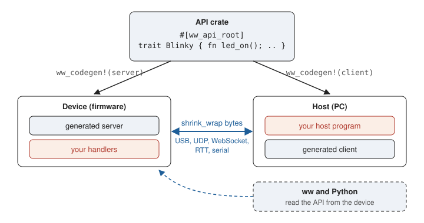

# WireWeaver { .visually-hidden }

{ width="420" }
{ width="420" }
{ style="text-align:center" }

WireWeaver is a set of Rust crates for the API between a device and a computer. You describe what the device offers
as one Rust trait, and WireWeaver generates the code for both ends: the [[server]] that runs in the device's firmware
and the [[client]] that a program on the computer calls. The two ends exchange bytes in [[ShrinkWrap]], a dense wire
format of its own.

[A first look](intro/first_look.md){ .md-button .md-button--primary }
[What WireWeaver does](intro/what_it_does.md){ .md-button }
[How to read this book](intro/reading.md){ .md-button }

## One trait, two ends

A device's API is a list of what a host may do with it: call a function, read or write a value, receive a stream of
readings. In WireWeaver that list is an [[API trait]], a Rust trait marked `#[ww_api_root]`, in a crate of its own.
The figure shows what grows from it.

The `ww_codegen!` macro reads the trait and writes the server on the device side. The server decodes each request,
calls the function you wrote for it, a [[handler]], and encodes the reply. On the host side the same macro writes a
client with one Rust function per item of the trait. Neither side hand-writes a byte of the protocol, so the two
can't disagree about it.

The device also carries a description of its own API. The `ww` command line tool and the Python package read that
description from the device and call it without any generated code. You can poke a new firmware from a terminal
before a host program for it exists.

## Who it is for

WireWeaver is for people who build a device and the software that talks to it: a sensor, a motor controller, a lab
instrument, a board on a test bench. It assumes that the firmware is written in Rust.

- **Firmware on small targets.** The server needs no allocator and no operating system. It runs on a Cortex-M0+,
  such as the STM32G0B1 of the book's board examples.
- **Host programs.** The client works with `async` Rust and with blocking calls.
- **Scripts and test benches.** Python and the `ww` tool call any device, so a calibration script needs no build
  step.

## What it is not for

- **APIs written in other languages.** The API is a Rust trait. A C program can read and write the wire format, and
  Python can call any device, but neither can declare an API.
- **A device that calls another device.** The client needs the standard library, so it runs on a computer, not in
  firmware.
- **Data that any tool must read without its type.** ShrinkWrap stores no field names, so a reader needs the type.
  JSON or CBOR suit data that strangers read.
- **A stable 1.0.** The crates and the wire format can still change between releases. Each change that breaks
  something is listed in the changelogs.

## Where to start

- [A first look](intro/first_look.md) runs a small device on your PC and calls it from the command line and from
  Python, in about five minutes.
- [What WireWeaver does](intro/what_it_does.md) goes through every area the book covers.
- [How to read this book](intro/reading.md) explains the four parts of the book and their reading levels.
