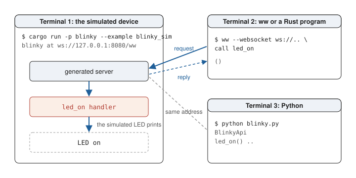

# A first look

This chapter runs a small device on your PC and calls it three ways: from a Rust program, from the `ww` command
line tool and from Python. It takes about five minutes and needs no board. Nothing is explained in depth here; the
Basic part builds the same device step by step, starting with [A device on your PC](../basic/first_device.md).

The device is blinky, an LED that a host turns on and off. On your PC, the LED is a line of text that the device
prints when it changes.

## Getting the code

Clone the repository and enter it. The examples build with the Rust toolchain that its `rust-toolchain.toml` names,
which `rustup` installs on the first build:

```sh
git clone https://github.com/vhrdtech/wire_weaver
cd wire_weaver
```

## Three terminals, one device

The device runs in one terminal and the hosts in others. They meet at a WebSocket address on your PC, as the figure
shows for one call.



Start the simulated device in the first terminal, and leave it running:

```sh
cargo run -p blinky --example blinky_sim
```

The first build takes a few minutes. Then the device prints `blinky at ws://127.0.0.1:8080/ww`, the address that
the hosts connect to.

## The API

Blinky's API is a Rust trait in [`examples/blinky_api/src/lib.rs`]. Each `fn` is a method that a host calls and
the device answers:

```rust
--8<-- "examples/blinky_api/src/lib.rs:root"
```

The device's side is a function per method, a [[handler]], in [`examples/blinky_device/src/lib.rs`]. Here are the
two that switch the LED:

```rust
--8<-- "examples/blinky_device/src/lib.rs:handlers"
```

Everything between the trait and the handlers, the decoding of requests and the encoding of replies, is generated
by WireWeaver.

## From a Rust program

The host program in [`examples/blinky/examples/host.rs`] calls the methods through a generated [[client]]. A call
is prepared, then sent with `.call()`, and `.await` waits for the answer:

```rust
--8<-- "examples/blinky/examples/host.rs:calls"
```

Run it in a second terminal:

```sh
cargo run -p blinky --example blinky_host
```

The device's terminal prints `LED on` and `LED off`. The program then calls two more methods and prints:

```console
--8<-- "docs/generated/blinky/host.txt"
```

## From the command line

The `ww` tool talks to any WireWeaver device without code of its own for it. Inside the repository, `cargo ww` runs
it without installing anything; [From the command line](../basic/command_line.md) shows how to install it. The
device tells `ww` its API, so `introspect` prints the trait you saw above, with the doc comments:

```ww
--8<-- "docs/generated/blinky/introspect.txt"
```

`call` calls a method by name, with its arguments in parentheses:

```ww
--8<-- "docs/generated/blinky/call.txt"
```

`set_led` returns whether the LED was on before, and `blinks` counts how often the LED went on. The count carries
its unit, `item`, because the API declares it as a count of items rather than a bare number.

## From Python

The Python module also learns the API from the device, so a script calls any device without a build step. Building
the module takes a few minutes the first time; [From Python](../basic/python.md) has the steps. The script
[`examples/blinky_dyn_py/blinky.py`] connects to the simulated device and calls its methods as Python methods:

```python
--8<-- "examples/blinky_dyn_py/blinky.py:calls"
```

Run from `examples/blinky_dyn_py`, it prints the API and the answers:

```console
--8<-- "docs/generated/blinky/blinky_py.txt"
```

The last line is a call that never left your PC. `set_led` takes a `bool`, so the module refuses the string
`'yes'` before it sends anything.

## What you saw

- One Rust trait described the device. The device code and the Rust client were generated from it.
- The same device answered a Rust program, a command line tool and a Python script, and the last two needed no code
  for it.
- Types travelled with the API: the count kept its unit, and a wrong argument was refused on the host.

The same device code runs on a board over USB; [On a real board](../basic/board.md) flashes it onto a Nucleo
G0B1RE. [Why a wire format of its own](wire_format.md) looks at the bytes these calls are made of.
