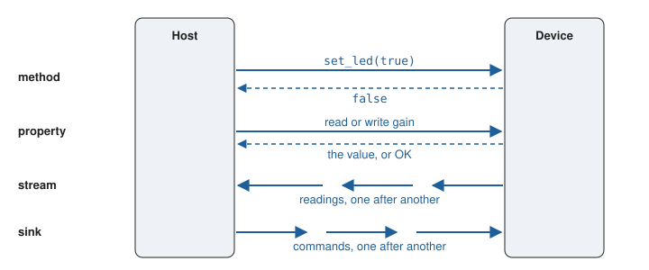

# What WireWeaver does

This chapter walks through every area that WireWeaver covers, one section each. Every section says what the area is
for and lists the chapters that teach it. Read it to see what is there before you start, or come back to it later
to find the chapter for a task.

The figure follows one call from a host program to a device and back. Each layer of the call is one area of this
chapter.

## Your data on the wire

[[ShrinkWrap]] is the wire format: it turns your structs and enums into bytes and back. A `bool` takes one bit,
small numbers take a nibble, and the format stores no field names. It reads in place, without copying and without an
allocator, so a firmware can read a message straight out of its receive buffer. The format also works on its own,
for a radio packet or a record in a log file.

A type is [[evolvable]] by default: a later version may add fields, and old and new readers still read each other's
bytes.

- [Your types on the wire](../basic/types_on_the_wire.md) puts a first struct into bytes.
- [Borrowed and owned](../basic/borrowed_and_owned.md), [Built-in types](../basic/built_in_types.md) and
  [Types that change](../basic/types_that_change.md) follow it.
- [Why a wire format of its own](wire_format.md) compares its sizes with eight other formats.

## An API as a Rust trait

An [[API trait]] lists what a device offers. It has four kinds of items, and the figure shows which way each one
goes:

- A [[method]] is a call with arguments and a return value: `fn set_led(on: bool) -> bool`.
- A [[property]] is a value a host reads, writes or both, such as a mode or a gain.
- A stream sends values from the device to the host, such as readings. A sink sends them the other way.
- A nested trait groups items, and an [[array]] of them serves several channels of the same kind.

The chapters that teach them:

- [A device on your PC](../basic/first_device.md) and [Methods](../basic/methods.md) for methods.
- [Properties](../basic/properties.md) and [Watching a value](../basic/observing.md) for properties.
- [Streams and sinks](../basic/streams.md) and [Channels](../basic/channels.md) for the rest.

## Numbers with their units

A number in an API carries its unit, its step and its limits in its type. A temperature in hundredths of a kelvin,
stored in an `i16`, is `Fixed<Kelvin, Centi, i16>`. On the wire it is the same two bytes as a bare `i16`, so the type
costs nothing. Clients, the command line tool and Python then know what the number means, and they refuse a value
outside its [[bounds]] before they send it.

- [Numbers that know their unit](../basic/units.md) introduces these types.
- [Temperatures and timestamps](../basic/temperatures.md) adds points on a scale and readings with their time.

## Server and client from one source

`ww_codegen!` generates the [[server]] for the firmware and the [[client]] for the host from the API trait. The
server works without an allocator and without an operating system. The generated code never touches the transport,
so the same device code runs in a simulation on your PC and on a board. The host's client can be called with
`async`, blocking or promise-style calls.

Errors are part of the API. A method returns its own error enum or one of the common errors every API shares, and
the host handles both with one `?`.

- [A device on your PC](../basic/first_device.md) builds both ends.
- [On a real board](../basic/board.md) runs the same device code on a Nucleo board.
- [Errors](../api/errors.md) covers what a call can return.

## Getting connected

A transport carries the bytes between host and device. WireWeaver has USB, UDP, WebSocket and RTT, the debug
probe's channel, and it runs over any byte stream, such as a UART. Two layers sit between the API and every
transport. The [[framer]] packs small messages into one packet and splits large ones across several. The
[[link layer]] checks that the two ends speak compatible versions of the API before the first call.

- [Choosing a transport](../basic/transports.md) compares the transports, and the chapters after it cover each one.
- [When the device goes away](../basic/connection_loss.md) keeps a host trying while a device resets or is
  unplugged.

## Tools that need no generated code

A device carries a description of its own API, and [[introspection]] lets a tool read it. The `ww` command line tool
lists the devices it finds, prints a device's API tree, calls methods, reads, writes and observes properties, and
updates firmware. The Python package builds an object for the device at run time, so a script calls
`dev.set_led(True)` on any firmware without a build step. Both check units and bounds as the Rust client does.

- [From the command line](../basic/command_line.md) introduces `ww`.
- [From Python](../basic/python.md) introduces the Python package.
- [Python in full](../python.md) covers streams, observing and log files from a script.

## The standard library

Most devices need the same things: pins, serial ports, buses, firmware information, a log, a firmware update. The
standard library has ready-made API traits for them, such as `ww_gpio`, `ww_uart`, `ww_can_bus`, `ww_i2c` and
`ww_dfu`. A device builds its API from these traits and its own items. Every tool that knows a standard trait then
works with every device that serves it.

- [Using the standard library](../std_library/using.md) builds a device from standard traits.
- [A UART bridge](../std_library/uart_bridge.md) bridges a serial device to the PC.
- [A device that tells about itself](../std_library/device_info.md) adds the information every device reports.

## Changing an API without breaking it

Firmware and host programs are updated at different times, so an old host meets new firmware and the other way
round. WireWeaver lets an API grow in a way that keeps both working: new methods, properties and fields come with a
version mark, and both ends compare versions when they connect. The [[evolution checker]] compares two versions of an
API and says whether the change breaks anything, so you learn it before a device ships.

- [Changing your API](../evolution/overview.md) adds a method to the first device and runs the checker on it.
- [Evolution in depth](../evolution/versions.md) covers versions, the rules for each kind of change, and hosts that
  talk to several generations of a device.

## Watching a running device

A host can [[observe]] a property instead of reading it again and again: the device sends each new value as it
changes. A motor controller with dozens of variables at several rates can be watched live this way, within a
budget of bytes per second that the device grants. Streams can send values in batches, keep running totals, and
compress series of samples. Counted streams tell the host when an item was lost.

- [Watching a value](../basic/observing.md) is the Basic chapter.
- [Observing in depth](../api/observing.md), [batching](../api/batching.md) and the
  [motor controller](../examples/motor_demo.md) cover the rest.

## Beyond one device and one host

The same API can be served by more than a device:

- A program can use the API as a plain Rust trait in the same process, and switch to a remote device without changing
  its calls ([local trait](../api/local_trait.md)).
- A service on a computer can serve its API to many clients at once ([host server](../api/host_server.md)).
- A slot in an API can hold an API known only at run time, such as an extension served by another process or a
  WebAssembly module loaded onto the device ([mounts](../api/mounts.md)).
- The per-user [[hub]] holds the devices of a computer and shares each of them between several programs
  ([local sockets and the hub](../transport/hub.md)).

## What it costs on a microcontroller

Firmware lives with small flash, little RAM and interrupts that must stay short. WireWeaver measures what its code
costs there: the flash of a server and of each feature, the stack of the hot paths, and the instructions of the
encoders. The measurements are part of the repository and run again when the code changes.

- [What a server costs in flash](../articles/flash_budget.md) gives the flash of a server, feature by feature.
- [Code size on small CPUs](../serdes/code_size.md) explains where the bytes of the wire format go.

## What is done and what is planned

Each area has more items than this chapter names, and some are planned rather than done. The feature trackers of
WireWeaver and of the repositories it uses list every item with its status, and the Reference links them.
[How to read this book](reading.md) explains how the parts of this book build on each other.
