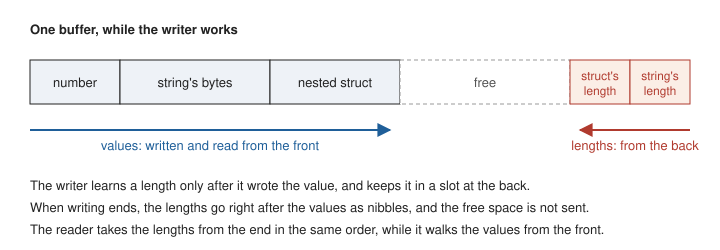

# Why a wire format of its own

Every request, reply and stream item in WireWeaver is encoded in [[ShrinkWrap]], a wire format written for it. This
chapter says what a device API needs from a wire format, how ShrinkWrap provides it, and how its sizes compare with
eight other formats on the same messages.

## What a device API needs

A firmware on a small microcontroller reads and writes every message, often in a few kilobytes of RAM and without
an allocator. The link to the host is often slow or has small packets: a full-speed USB packet holds 64 bytes, and a
CAN frame 8 or 64. The firmware and the host are also updated at different times, so each side meets messages
written by an older or a newer version of the other.

So the format must do four things at once:

- **Work without an allocator,** also for strings, lists and nested types, for both reading and writing.
- **Read in place.** A string or a list in a received message is used where it lies in the buffer, without a copy.
- **Be small,** because every byte costs time on the link and room in a packet.
- **Let types change.** A new field must not break a reader that doesn't know it, and an old message must still
  read in new code.

Each kind of existing format gives up one of the four:

| Kind of format | Examples | What it gives up |
|---|---|---|
| Field names in the data | JSON, CBOR, MessagePack with names | Size: every message carries its names. |
| Positional | postcard, wincode | Change: a new field breaks every old reader. |
| Schema with field numbers | protobuf | No allocator: its usual Rust implementations allocate when they read. |
| Built for random access | FlatBuffers | Size: offsets and field tables travel with the data. |

## How ShrinkWrap stays small

ShrinkWrap is small for three reasons:

- **Bits are packed.** A `bool` takes one bit, a 3-bit number three bits, and an enum with four variants can take
  two bits. Byte-sized values, such as a `u8`, an `f32` or a string, start on a fresh byte, and the unused bits before
  them stay zero. A later version of a type can put a new `bool` or an `Option` flag into those bits, and old data then
  reads as `false` or `None`.
- **Lengths go to the back.** A string, a list or a nested type needs its length stored somewhere. Most formats write
  it in front of the value, so the writer must know the size before it writes the value. ShrinkWrap writes the value
  first and keeps its length in a slot at the back of the buffer. When writing ends, the lengths follow the values as
  numbers of 4-bit nibbles that grow with the length, so a small length costs half a byte. Writing stays a single
  pass without copying. The reader takes the lengths from the end while it walks the data from the front.
- **Nothing extra by default, less if you ask.** No field names and no type tags are stored: the reader knows the
  type. A struct is [[evolvable]] by default, which costs a length nibble or two when it is nested in another type. A
  type that will never change can say so, and then it costs exactly its fields. Layout directives go further, field by
  field: a number written in 12 bits, a variable-length integer, or a struct that stores only the fields that are set.

The figure shows the second reason. Values grow from the front of the buffer and lengths from its back, so
neither waits for the other:

## Sizes compared

The `compare_wire_formats` example encodes eight messages in ShrinkWrap and in eight other pure-Rust formats:

- postcard and wincode, positional formats;
- MessagePack, JSON and CBOR, which can carry field names;
- protobuf and FlatBuffers, which have schemas;
- ASN.1 UPER, the Unaligned Packed Encoding Rules of ASN.1, which packs bits as ShrinkWrap does.

The messages range from a call header made of small enums and flags to a firmware chunk that is mostly a 256-byte
blob. Each format uses the settings that a project which cares about size would pick.

The chart sums each format up in one number: its size divided by the smallest encoding of the same message,
averaged over the eight messages. A format that is always the smallest scores 1.00. The colour says how the format
lets a later revision add a field, because a format that gives that up is not smaller for free.

<figure>
--8<-- "docs/generated/compare_wire_formats/wire_sizes.svg"
</figure>

WireWeaver (tuned) is ShrinkWrap with layout directives, and it is the smallest or tied for the smallest on every
message. WireWeaver (plain) is the same types without directives. It is close to postcard, while it keeps the
ability to add fields that postcard lacks. The formats with field names are four to seven times larger. FlatBuffers
is built for access to any field without decoding the rest, and its offsets and field tables cost size.

The chart comes from the example's output and is checked against it, so it can't drift from the code. Sizes depend
on the messages and their values, so measure your own: the messages are plain Rust types in
`examples/compare_wire_formats/src/msgs/`.

## Where to go next

- [Wire sizes compared](../examples/wire_sizes.md) in the Reference lists every message, every format's setting and
  the bytes of each encoding.
- [Your types on the wire](../basic/types_on_the_wire.md) starts the Basic part: it puts your first struct into
  ShrinkWrap bytes and reads them bit by bit.
- [How to read this book](reading.md) explains the parts and reading levels of the book.
