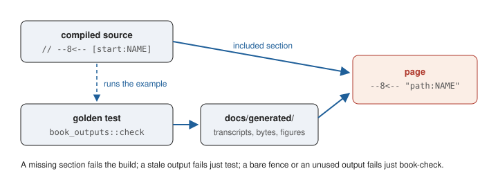

# For writers

This page is for people who write or change pages of this book. It describes the front matter, the links, the
includes and the fences that every page uses, and the checks that keep them true. The figure shows where the code
and the outputs on a page come from.



## Levels and parts

The badge above a page's title comes from its front matter and is drawn by [`overrides/partials/level.html`]. The
navigation reads as one book in four parts, Introduction, Basic, Advanced and Nomicon, each holding pages of one
level. The Reference and the Articles follow, outside that order. `just book-check` checks the frame from
`book_checks.toml`:

- A page has a level: `level: basic`, `level: advanced` or `level: nomicon`.
- A page is listed once in the navigation.
- A page sits in the part of its level, so reading on never steps down a level.

## Files, items and terms

A name in the text that matches nothing, or more than one thing, fails the build. A renamed file or item therefore
can't leave a stale link. The forms are:

| What | Written as | The reader gets |
|---|---|---|
| A file | `` [`examples/thermometer/examples/read.rs`] `` | A card with the code on hover, the lines on GitHub on click. |
| A marked section | `` [`examples/thermometer/tests/it/book.rs:gain_bounds`] `` | The same, for the section's lines. |
| A Rust item | `` [`GetResult`] `` | Its signature and docs; its crate must be in `code_refs`' `crates` in `zensical.toml`. |
| A glossary term | `` [[property]] `` | Its short definition, and a link to its entry. |

A path that names no file, such as a folder or a file that a reader creates, stays a code span.

## Code and output

- Outside the Nomicon, a `rust` fence holds only an include of a marked section of a compiled source:
  `// --8<-- [start:NAME]` and `// --8<-- [end:NAME]` in the source, `--8<-- "path/to/file.rs:NAME"` in the fence.
- A Nomicon page may also show a sketch, a fence titled `title="sketch: ..."`.
- What a reader would see when running an example, such as a transcript, bytes or a chart's data, is written by a
  golden test into `docs/generated/` through the `book_outputs` crate and included the same way.
  `just book-outputs` writes them again, and a stale one fails `just test`.
- A transcript of `ww` goes into a `ww` fence, which colours its commands, API trees, numbers, versions and errors
  ([`docs_ext/ww_docs_ext/ww_lexer.py`]). Other shell sessions go into a `console` fence.
- The pages not rewritten yet keep their bare fences, counted in `book_checks.toml`.

## Bit layouts

A Nomicon or Advanced page that shows how bits are laid out uses a `bits` fence: one field per line, its kind, its
bits (groups of `0` and `1`), then its label. The site draws every bit in its byte, coloured by kind, with each
byte's hex below and a table of the fields with their bit offsets. A `bytes` line checks the fields: the build fails
when they don't make those bytes (MSB first, as `shrink_wrap` writes them). Take the bytes from a real run, a test
or a scratch example as `AGENTS.md` describes, never from the bits by hand.

````text
```bits
head  0100              n = 4
run   0001 0            `v.prefix` run: `Milli`, end
value 0000110011100100  3300
width 00010             block width 2
delta 10 00 11          +1 0 -2 (zigzag 2 0 3)
pad   00                padding
bytes 42 11 ..
```
````

| Kind | Holds |
|---|---|
| `head` | Counts, field counts, codec headers. |
| `run` | Tag runs. |
| `value` | Full values. |
| `delta` | Residuals and other coded data. |
| `width` | Block widths. |
| `pad` | Padding. |

The label starts at the first word that isn't only `0` and `1`, and it may hold `code`.
[The column layout](../articles/series.md#the-column-layout) is a worked example. The fence is
[`docs_ext/ww_docs_ext/bits.py`], with tests in `docs_ext/tests` that `just test` runs, and its colours are
`.ww-bits` in [`docs/stylesheets/vhrd.css`].

## Figures

A chapter has a figure for each mechanism it explains, placed right after the sentence that needs it.

- A figure drawn by hand is an SVG in `docs/assets/`, with a `<title>` and a `<desc>` that say in words what it
  shows.
- A figure drawn from data, such as a timeline of a test's run or a chart of measured sizes, is written by the test
  that makes the data into `docs/generated/`. A stale figure then fails `just test` like a stale transcript.

A generated figure is included inline, inside a `<figure>` element, with a snippet line of its own:

```text
<figure>
;--8<-- "docs/generated/compare_wire_formats/wire_sizes.svg"
</figure>
```
