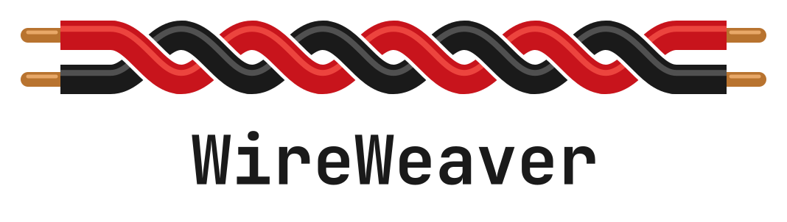

# WireWeaver

<picture>
  <source media="(prefers-color-scheme: dark)" srcset="https://raw.githubusercontent.com/vhrdtech/wire_weaver/master/docs/assets/wire_weaver_logo-dark.png">
  
</picture>

> WireWeaver is a wire format and API code generator for resource constrained systems.

This is the runtime crate: the handler `Context`, events, the server backend traits and `RpcResult`. It re-exports:

* `ww_api` - what an API crate uses to describe an API (the macros, the markers, the `shrink_wrap` prelude, `ww_error`); its prelude is part of this crate's prelude
* `shrink_wrap` - wire format and derive macros
* `ww_version` - SemVer for no_std no alloc systems

An API crate depends on `ww_api` alone; server and client crates depend on this crate.

By default, this crate has `std` feature enabled, when using on `no_std`, add `default-features = false`.

Please see the [main repo](https://github.com/vhrdtech/wire_weaver)
or [documentation](https://vhrdtech.github.io/wire_weaver) for more information.